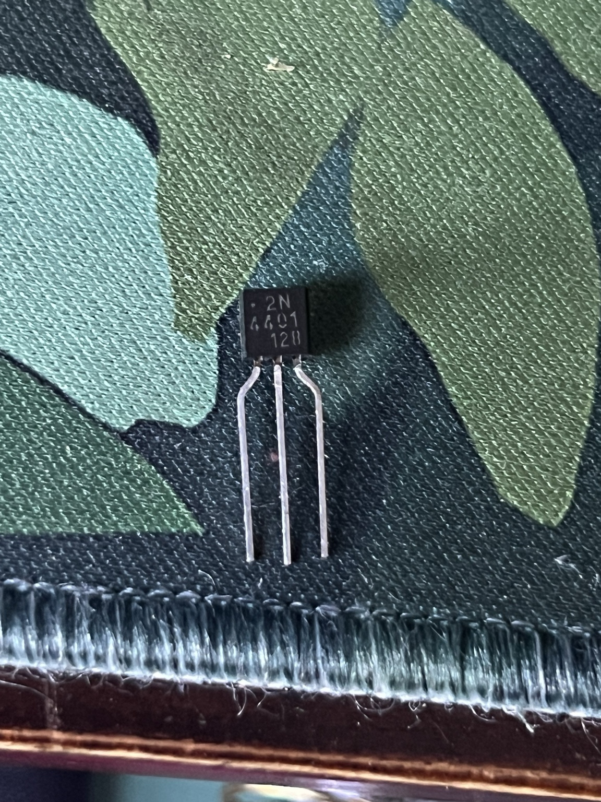
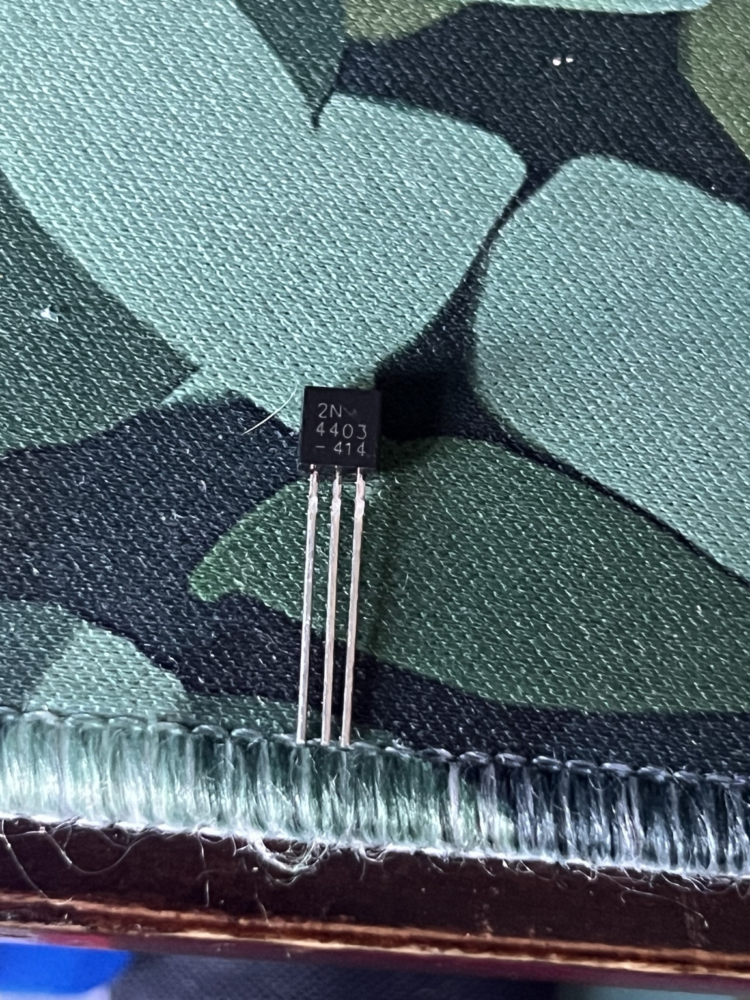
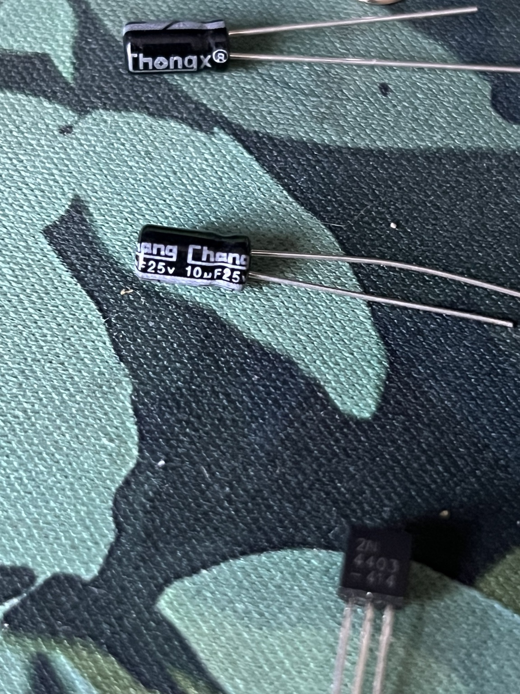
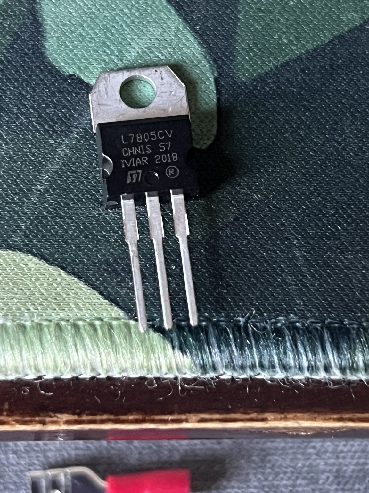
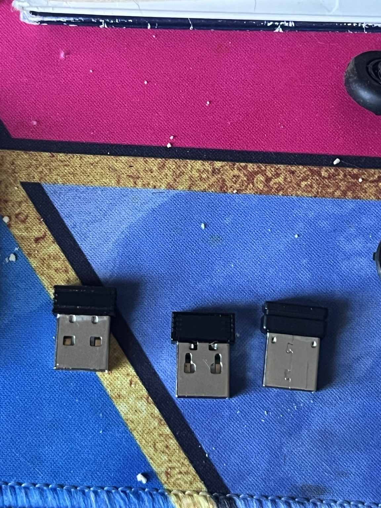
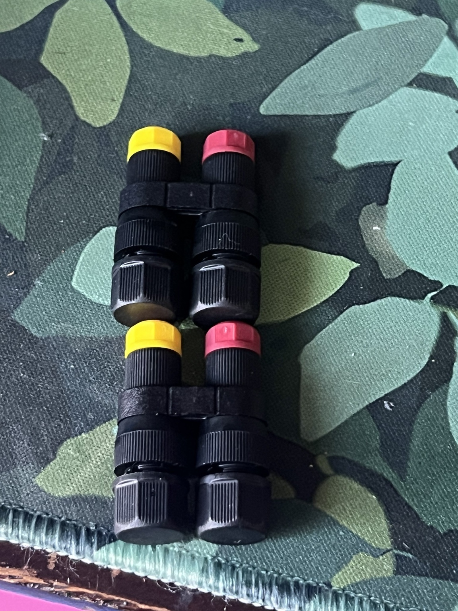
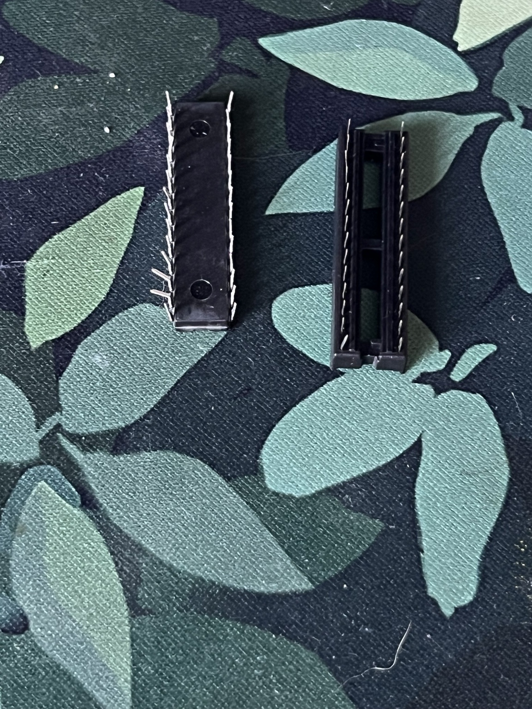
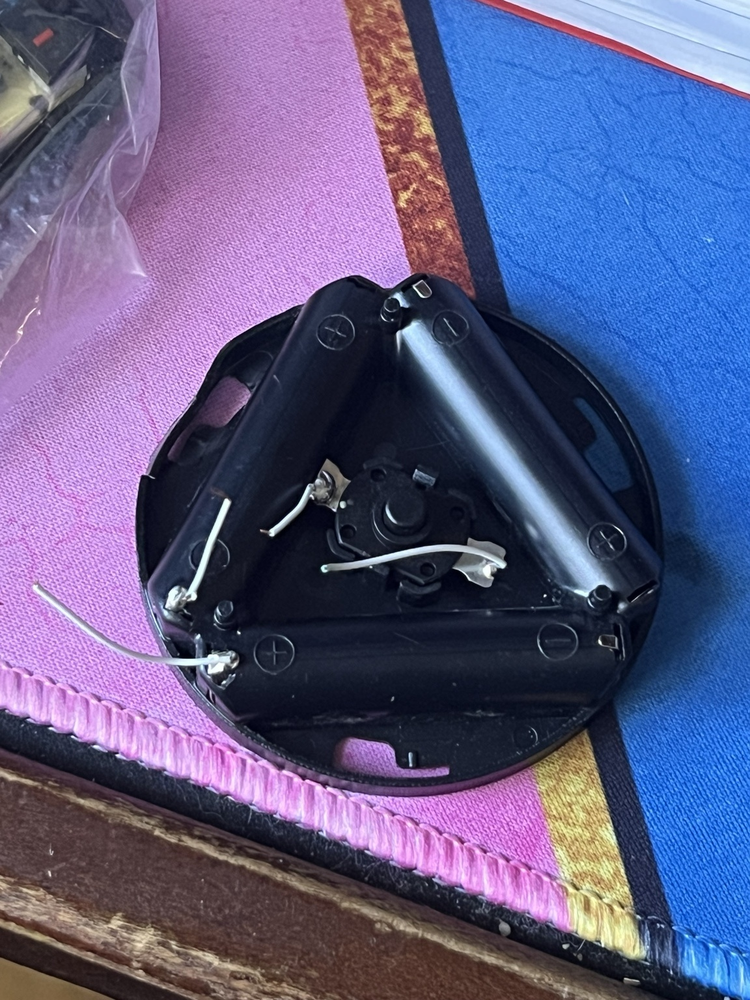
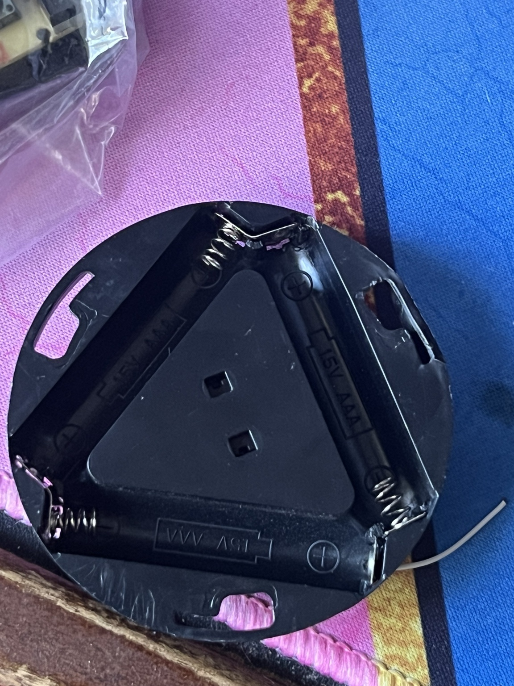

# Owner photo identifications — October 25, 2026

Identification supplement, not new deliveries or extra stock. Related Rev 4 groups may contain these same parts. Repeated views do not add quantities. No electrical function or optical receiver performance established.

Nine source photographs are published at the owner’s request. They are orientation-normalized copies with EXIF/GPS metadata omitted; scenes and part markings are not intentionally edited. Identification titles below are human-readable records, not electrical test results. The annotated chat contact sheets are not used as source evidence.

[Machine-readable JSON](owner-photo-identifications.json) · [CSV parts list](owner-photo-identifications.csv)

## Parts and photo evidence

### PHOTO-001 — 2N4401 NPN transistor

**Quantity:** At least 1. **Evidence:** Marking readable. **Status:** Not electrically tested.

**Earlier group:** REF-16.

**Potential use:** Warning LED output-switch candidate for B; does not complete optical detection.

**Limits / next check:** Verify exact manufacturer pinout and transistor function before wiring.

### PHOTO-002 — 2N4403 PNP transistor

**Quantity:** At least 1. **Evidence:** Marking readable. **Status:** Not electrically tested.

**Earlier group:** REF-16.

**Potential use:** Additional transistor stock; no assigned circuit role.

**Limits / next check:** Same part may appear in both photos; do not count twice or substitute for an NPN.

### PHOTO-003 — L7805CV — 5 V voltage regulator

**Quantity:** At least 1. **Evidence:** Marking readable. **Status:** Not electrically tested.

**Earlier group:** REF-16.

**Potential use:** Candidate regulator for a 5 V IR receiver supply using a suitable higher-voltage input.

**Limits / next check:** Not a working supply yet. Verify pinout, supporting capacitors, heat dissipation and loaded output. Cannot boost nominal 4.5 V to 5 V.

### PHOTO-004 — 10 µF, 25 V electrolytic capacitor

**Quantity:** At least 1. **Evidence:** Marking readable. **Status:** Not electrically tested.

**Earlier group:** REF-16.

**Potential use:** Supporting power-filtering capacitor candidate.

**Limits / next check:** Observe polarity; capacitance, leakage and condition untested. Not a substitute for every required regulator bypass capacitor.

### PHOTO-005 — Capacitor — value unknown ?

**Quantity:** At least 1. **Evidence:** Appearance only; value hidden. **Status:** Not electrically tested.

**Earlier group:** REF-16.

**Potential use:** Possible supporting capacitor after identification.

**Limits / next check:** Rotate to expose capacitance, voltage and polarity markings; do not assume it matches the other capacitor.

### PHOTO-006 — USB dongles — exact functions unknown ?

**Quantity:** 3 pieces / 1 group. **Evidence:** Connector shape visible; function unknown. **Status:** Not electrically tested.

**Earlier group:** REF-13.

**Potential use:** Unassigned USB accessories; no optical receiver role confirmed.

**Limits / next check:** Need labels or device identification; do not infer Wi-Fi, Bluetooth or mouse compatibility from shape.

### PHOTO-007 — Possible wire connectors — exact type unknown ?

**Quantity:** 2 paired assemblies visible / 1 group. **Evidence:** Appearance only; tentative identification. **Status:** Not electrically tested.

**Earlier group:** Not assigned; overlap with earlier stock unresolved.

**Potential use:** Possible connection hardware after identifying openings and wire requirements.

**Limits / next check:** Inspect openings, terminal mechanism and ratings; do not classify as sensors.

### PHOTO-008 — Unidentified many-pin component — part number unknown ?

**Quantity:** 1 visible. **Evidence:** Underside only; identity unresolved. **Status:** Not electrically tested.

**Earlier group:** REF-16.

**Potential use:** No receiver function assigned.

**Limits / next check:** Flip over and photograph all printed markings; may be another socket. No amplifier or comparator identified.

### PHOTO-009 — Empty IC socket

**Quantity:** 1 visible. **Evidence:** Open socket visible. **Status:** Not electrically tested.

**Earlier group:** REF-16.

**Potential use:** Holds a compatible IC on an appropriate assembly board.

**Limits / next check:** Not an amplifier or comparator; verify pin count and pitch.

### PHOTO-010 — Holder for three AAA batteries

**Quantity:** 1 holder. **Evidence:** Cell markings readable. **Status:** Not electrically tested.

**Earlier group:** REF-20.

**Potential use:** Potential removable-cell supply and mounting base.

**Limits / next check:** Two views of the same holder. Loose/cut wires require repair, continuity, polarity and voltage checks. Series wiring and switch operation not proven; do not call it a regulated 5 V source.

## Remaining tripwire gaps

- **B:** No suitable amplifier/threshold circuit identified; LED sensor measurements and circuit design still needed.
- **C:** No matched IR emitter/receiver pair identified. L7805CV is a candidate supply component, not a tested 5 V supply.

Reference: [ST L78 datasheet](https://www.st.com/resource/en/datasheet/l78.pdf). Regulator identification is based on IMG_9285; successful regulation has not been measured.
