# McGruber photo inventory — October 25, 2026

**16 part/group records · 35 distinct source photos.**

Identification supplement, not new deliveries or extra stock. Related Rev 4 groups may contain these same parts. Repeated views do not add quantities. No electrical function or optical receiver performance established.

All 38 available uploads in this conversation: 35 distinct source views IMG_9283–IMG_9317; three byte-identical remote-photo copies are aliases, not additional views.

Source copies omit EXIF/GPS metadata and normalize orientation. Annotated SVGs embed the corresponding source JPEG bytes unchanged and add titles, numbered markers and labels. AI-generated contact sheets were rejected because they altered component shapes and are not included. Source photographs and written records remain authoritative. A question mark means identification is uncertain. No electrical function has been tested.

[JSON manifest](owner-photo-identifications.json) · [CSV parts list](owner-photo-identifications.csv) · [Photo review workflow](PHOTO_REVIEW_WORKFLOW.md)

## Annotated images

## All source photographs and annotations

### IMG_9283.jpeg — 2N4401 transistor

**Donor / group:** Loose parts / accessories. **Status:** Not electrically tested.

- 2N4401 marking readable

[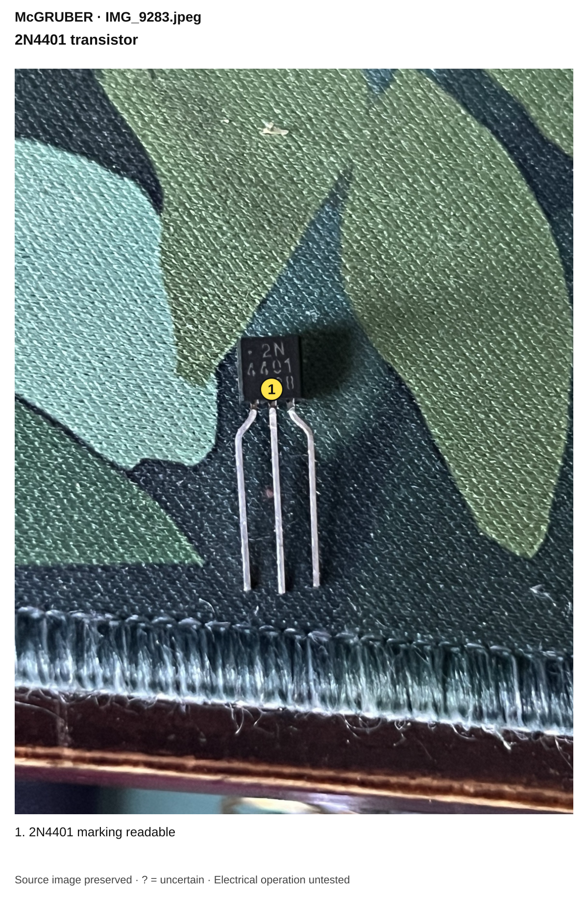](../media/parts/2026-10-25/IMG_9283_annotated.svg)

[Open source photo](../media/parts/2026-10-25/IMG_9283.jpeg) · [Open annotated image](../media/parts/2026-10-25/IMG_9283_annotated.svg)

Uploaded names: IMG_9283.jpeg.

### IMG_9284.jpeg — 2N4403 transistor

**Donor / group:** Loose parts / accessories. **Status:** Not electrically tested.

- 2N4403 marking readable

[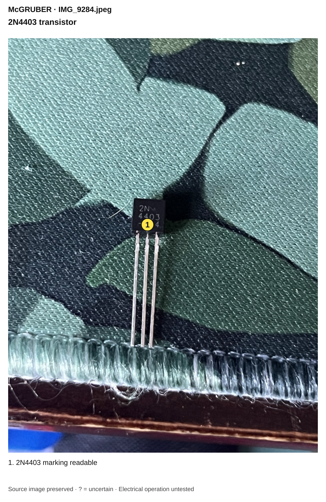](../media/parts/2026-10-25/IMG_9284_annotated.svg)

[Open source photo](../media/parts/2026-10-25/IMG_9284.jpeg) · [Open annotated image](../media/parts/2026-10-25/IMG_9284_annotated.svg)

Uploaded names: IMG_9284.jpeg.

### IMG_9285.jpeg — L7805CV — 5 V regulator

**Donor / group:** Loose parts / accessories. **Status:** Not electrically tested.

- Regulator component; operation untested

[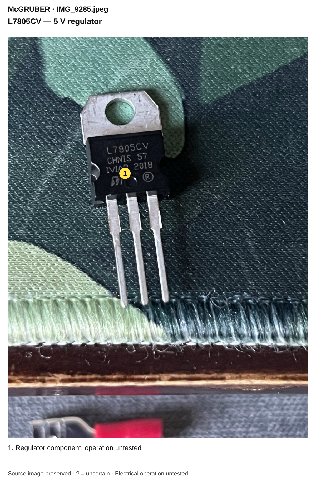](../media/parts/2026-10-25/IMG_9285_annotated.svg)

[Open source photo](../media/parts/2026-10-25/IMG_9285.jpeg) · [Open annotated image](../media/parts/2026-10-25/IMG_9285_annotated.svg)

Uploaded names: IMG_9285.jpeg.

### IMG_9286.jpeg — Capacitors and transistor

**Donor / group:** Loose parts / accessories. **Status:** Not electrically tested.

- Upper capacitor: value ?
- Middle capacitor: 10 µF 25 V
- Lower part: 2N4403 transistor

[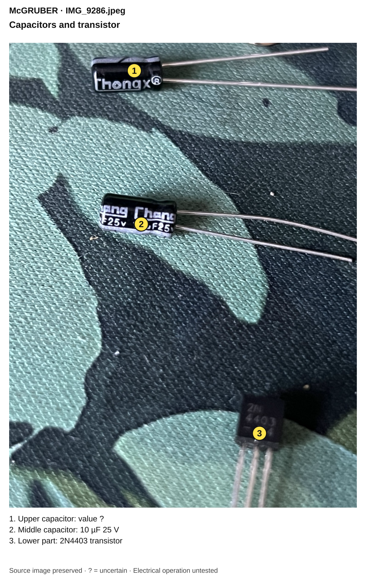](../media/parts/2026-10-25/IMG_9286_annotated.svg)

[Open source photo](../media/parts/2026-10-25/IMG_9286.jpeg) · [Open annotated image](../media/parts/2026-10-25/IMG_9286_annotated.svg)

Uploaded names: IMG_9286.jpeg.

### IMG_9287.jpeg — USB dongles — function ?

**Donor / group:** Loose parts / accessories. **Status:** Not electrically tested.

- Three USB dongles; identities unknown

[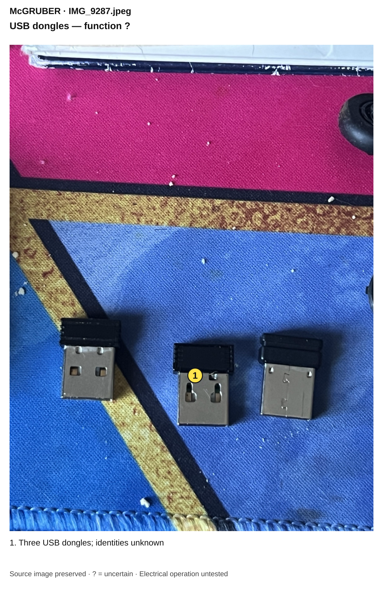](../media/parts/2026-10-25/IMG_9287_annotated.svg)

[Open source photo](../media/parts/2026-10-25/IMG_9287.jpeg) · [Open annotated image](../media/parts/2026-10-25/IMG_9287_annotated.svg)

Uploaded names: IMG_9287.jpeg.

### IMG_9288.jpeg — Wire connectors — type ?

**Donor / group:** Loose parts / accessories. **Status:** Not electrically tested.

- Two paired assemblies; exact type unknown

[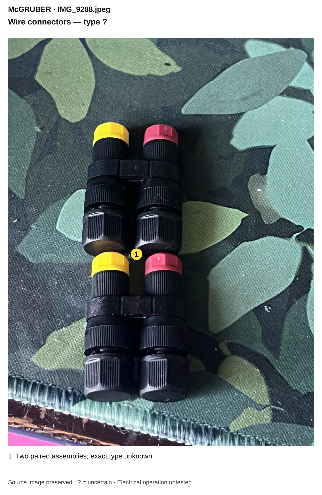](../media/parts/2026-10-25/IMG_9288_annotated.svg)

[Open source photo](../media/parts/2026-10-25/IMG_9288.jpeg) · [Open annotated image](../media/parts/2026-10-25/IMG_9288_annotated.svg)

Uploaded names: IMG_9288.jpeg.

### IMG_9289.jpeg — Chip underside and empty socket

**Donor / group:** Loose parts / accessories. **Status:** Not electrically tested.

- Left: chip underside; linked PIC identification in 9297
- Right: empty IC socket

[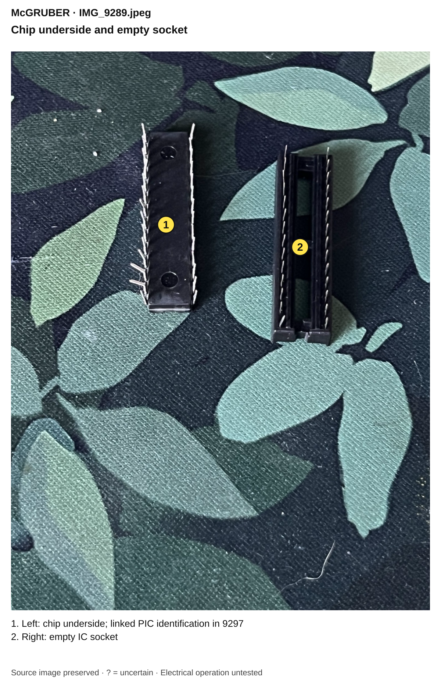](../media/parts/2026-10-25/IMG_9289_annotated.svg)

[Open source photo](../media/parts/2026-10-25/IMG_9289.jpeg) · [Open annotated image](../media/parts/2026-10-25/IMG_9289_annotated.svg)

Uploaded names: IMG_9289.jpeg.

### IMG_9290.jpeg — Three-AAA holder — wiring side

**Donor / group:** Loose parts / accessories. **Status:** Not electrically tested.

- Loose/cut wires
- Same holder as photo 9291

[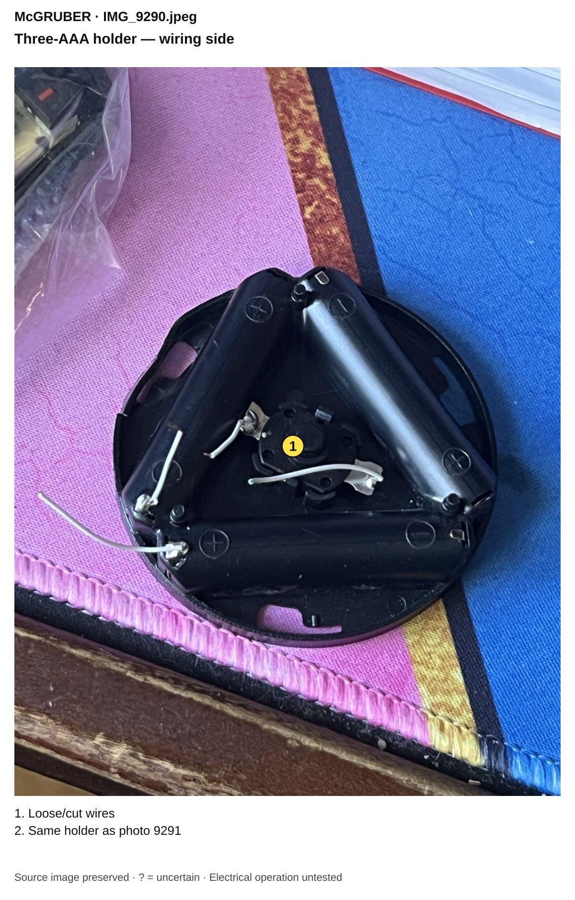](../media/parts/2026-10-25/IMG_9290_annotated.svg)

[Open source photo](../media/parts/2026-10-25/IMG_9290.jpeg) · [Open annotated image](../media/parts/2026-10-25/IMG_9290_annotated.svg)

Uploaded names: IMG_9290.jpeg.

### IMG_9291.jpeg — Three-AAA battery holder

**Donor / group:** Loose parts / accessories. **Status:** Not electrically tested.

- AAA 1.5 V markings readable
- Output and wiring untested

[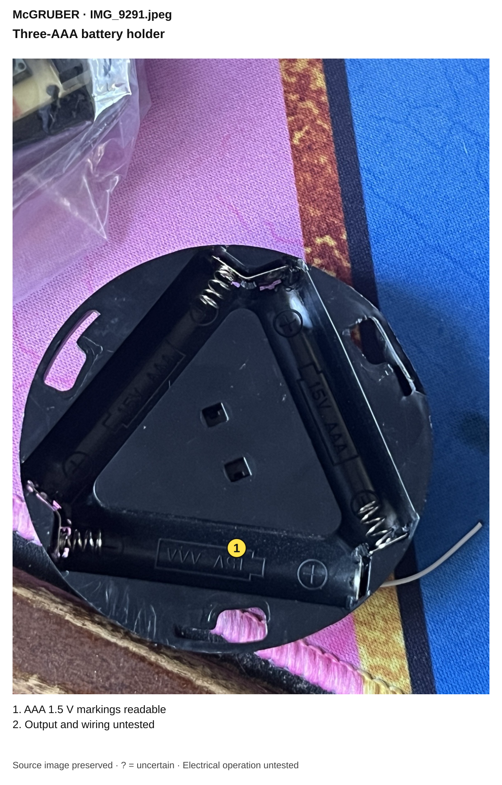](../media/parts/2026-10-25/IMG_9291_annotated.svg)

[Open source photo](../media/parts/2026-10-25/IMG_9291.jpeg) · [Open annotated image](../media/parts/2026-10-25/IMG_9291_annotated.svg)

Uploaded names: IMG_9291.jpeg.

### IMG_9292.jpeg — Black alligator test leads

**Donor / group:** Loose parts / accessories. **Status:** Not electrically tested.

- Clip leads; continuity untested

[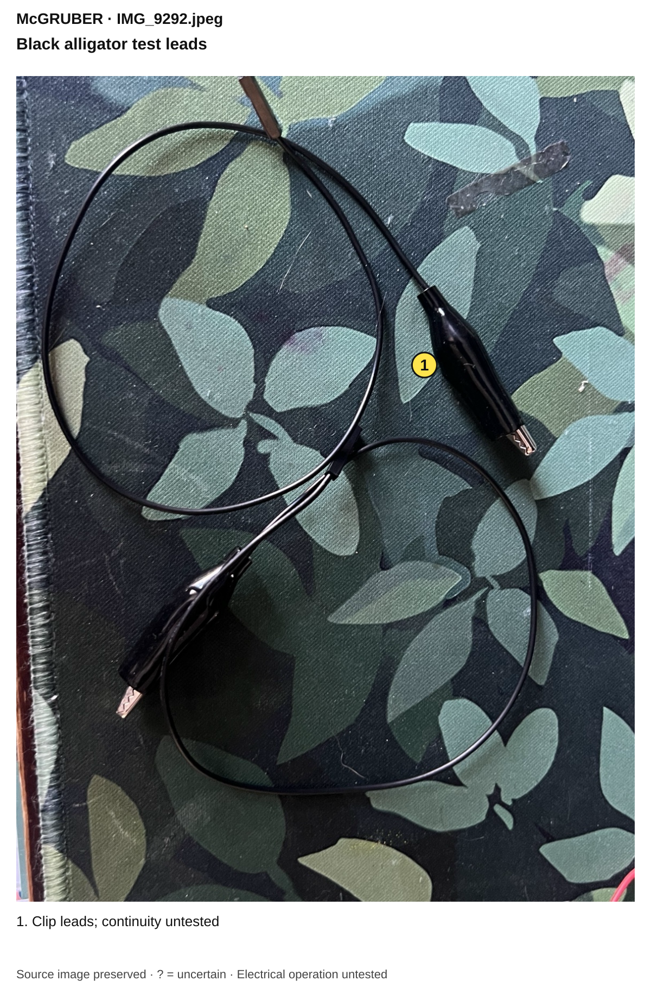](../media/parts/2026-10-25/IMG_9292_annotated.svg)

[Open source photo](../media/parts/2026-10-25/IMG_9292.jpeg) · [Open annotated image](../media/parts/2026-10-25/IMG_9292_annotated.svg)

Uploaded names: IMG_9292(1).jpeg.

### IMG_9293.jpeg — Red clip-to-pin test leads

**Donor / group:** Loose parts / accessories. **Status:** Not electrically tested.

- Alligator clips
- Breadboard pin ends

[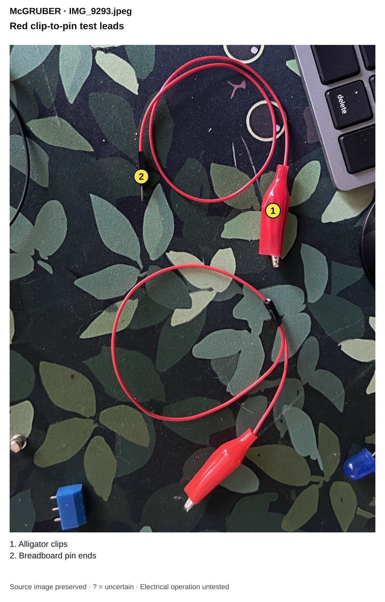](../media/parts/2026-10-25/IMG_9293_annotated.svg)

[Open source photo](../media/parts/2026-10-25/IMG_9293.jpeg) · [Open annotated image](../media/parts/2026-10-25/IMG_9293_annotated.svg)

Uploaded names: IMG_9293(1).jpeg.

### IMG_9294.jpeg — Crystal / resonator ?

**Donor / group:** Loose parts / accessories. **Status:** Not electrically tested.

- Metal-can component marked 160004
- Exact frequency/specification ?

[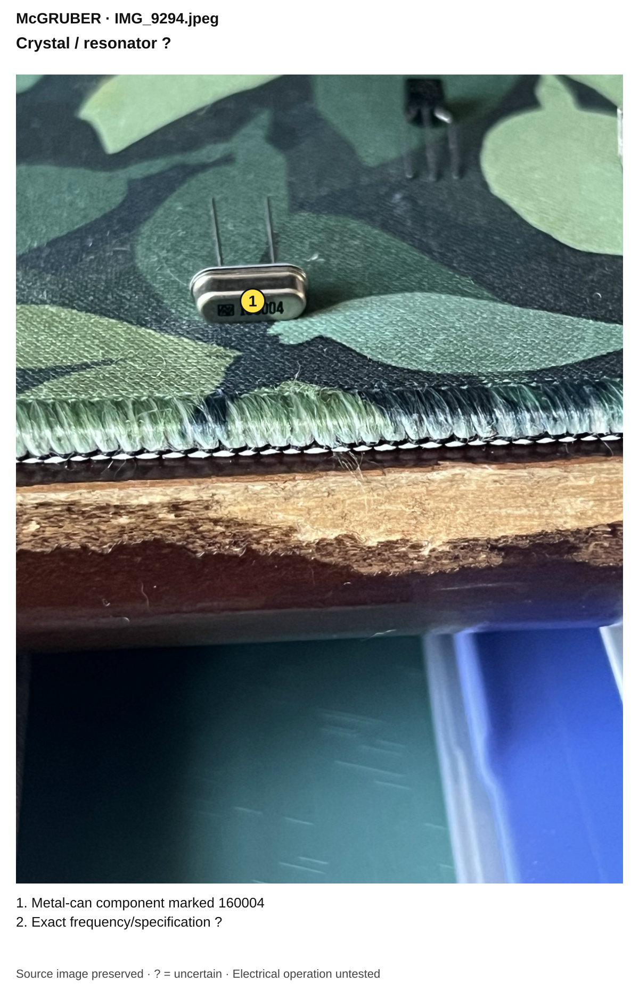](../media/parts/2026-10-25/IMG_9294_annotated.svg)

[Open source photo](../media/parts/2026-10-25/IMG_9294.jpeg) · [Open annotated image](../media/parts/2026-10-25/IMG_9294_annotated.svg)

Uploaded names: IMG_9294(1).jpeg.

### IMG_9295.jpeg — 2N4401 transistor — another view

**Donor / group:** Loose parts / accessories. **Status:** Not electrically tested.

- 2N4401 marking readable
- Not an additional quantity

[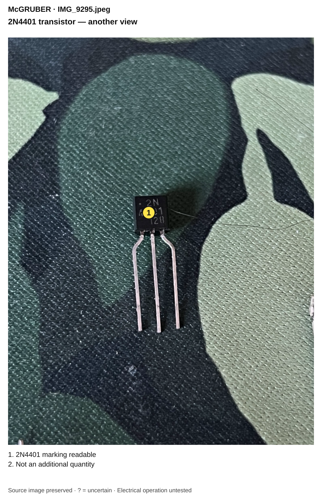](../media/parts/2026-10-25/IMG_9295_annotated.svg)

[Open source photo](../media/parts/2026-10-25/IMG_9295.jpeg) · [Open annotated image](../media/parts/2026-10-25/IMG_9295_annotated.svg)

Uploaded names: IMG_9295(1).jpeg.

### IMG_9296.jpeg — Chip underside and IC socket

**Donor / group:** Loose parts / accessories. **Status:** Not electrically tested.

- Underside of PIC candidate shown in 9297
- Empty socket; not a second chip

[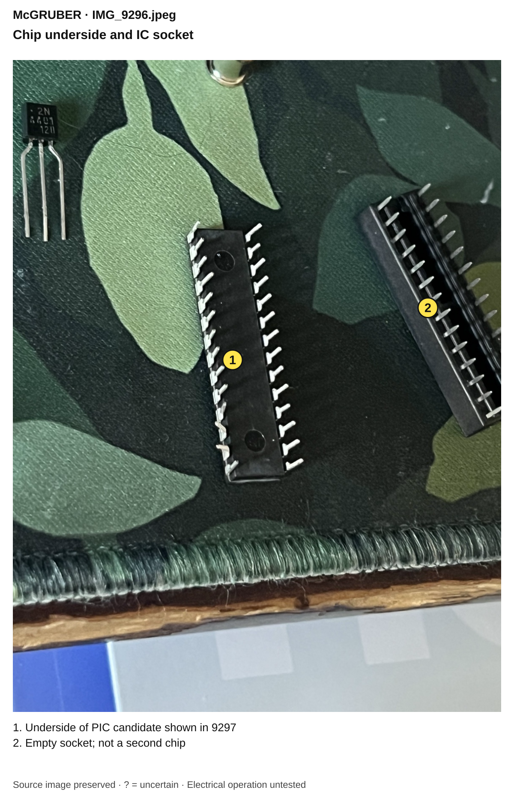](../media/parts/2026-10-25/IMG_9296_annotated.svg)

[Open source photo](../media/parts/2026-10-25/IMG_9296.jpeg) · [Open annotated image](../media/parts/2026-10-25/IMG_9296_annotated.svg)

Uploaded names: IMG_9296(1).jpeg.

### IMG_9297.jpeg — PIC16F57-E/SP and IC socket

**Donor / group:** Loose parts / accessories. **Status:** Not electrically tested.

- PIC16F57-E/SP programmable microcontroller
- Empty IC socket
- Not an LM358 or LM393

[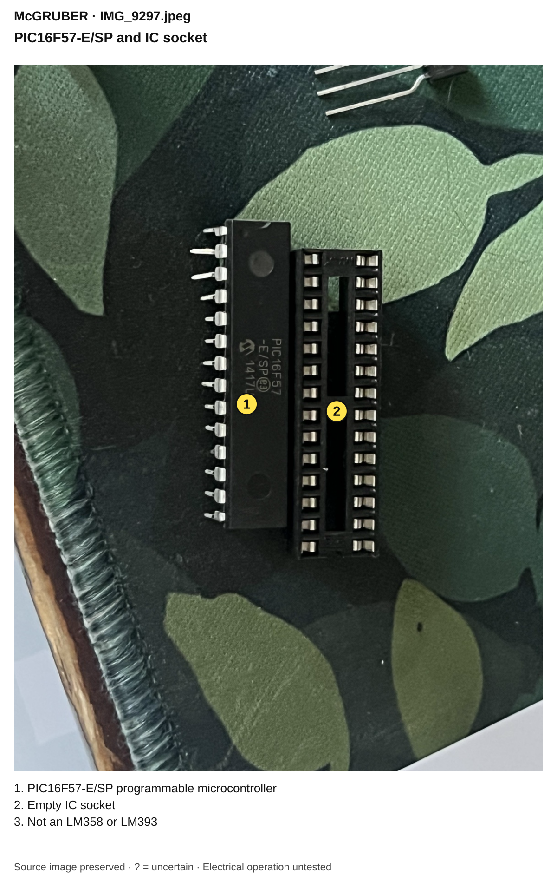](../media/parts/2026-10-25/IMG_9297_annotated.svg)

[Open source photo](../media/parts/2026-10-25/IMG_9297.jpeg) · [Open annotated image](../media/parts/2026-10-25/IMG_9297_annotated.svg)

Uploaded names: IMG_9297(1).jpeg.

### IMG_9298.jpeg — Resistor color-code reference card

**Donor / group:** Loose parts / accessories. **Status:** Not electrically tested.

- Printed chart, not resistor stock
- Blue part at edge: terminal block

[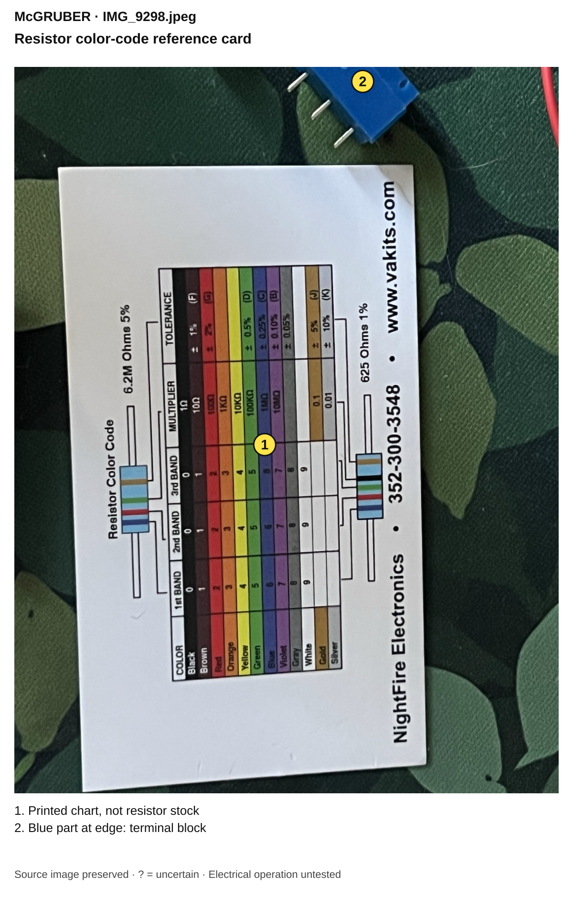](../media/parts/2026-10-25/IMG_9298_annotated.svg)

[Open source photo](../media/parts/2026-10-25/IMG_9298.jpeg) · [Open annotated image](../media/parts/2026-10-25/IMG_9298_annotated.svg)

Uploaded names: IMG_9298(1).jpeg.

### IMG_9299.jpeg — Amazon R-NZ remote — donor board

**Donor / group:** Amazon R-NZ remote. **Status:** Not electrically tested.

- R-NZ printed board marking
- Battery contacts
- Same remote as photos 9300–9304

[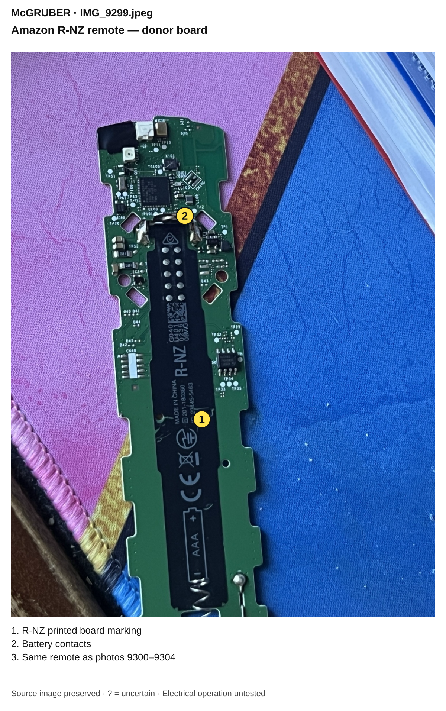](../media/parts/2026-10-25/IMG_9299_annotated.svg)

[Open source photo](../media/parts/2026-10-25/IMG_9299.jpeg) · [Open annotated image](../media/parts/2026-10-25/IMG_9299_annotated.svg)

Uploaded names: IMG_9299(2).jpeg, IMG_9299.jpeg.

### IMG_9300.jpeg — Remote board — component close-up

**Donor / group:** Amazon R-NZ remote. **Status:** Not electrically tested.

- Eight-pin chip: exact identity ?
- PCB pads and small components

[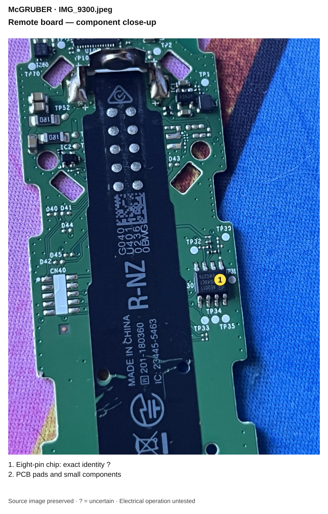](../media/parts/2026-10-25/IMG_9300_annotated.svg)

[Open source photo](../media/parts/2026-10-25/IMG_9300.jpeg) · [Open annotated image](../media/parts/2026-10-25/IMG_9300_annotated.svg)

Uploaded names: IMG_9300(2).jpeg, IMG_9300.jpeg.

### IMG_9301.jpeg — Remote board — controller and LEDs

**Donor / group:** Amazon R-NZ remote. **Status:** Not electrically tested.

- Main chip: CYW20735 marking
- LED50 / LED51: wavelength ?
- MIC10 microphone package

[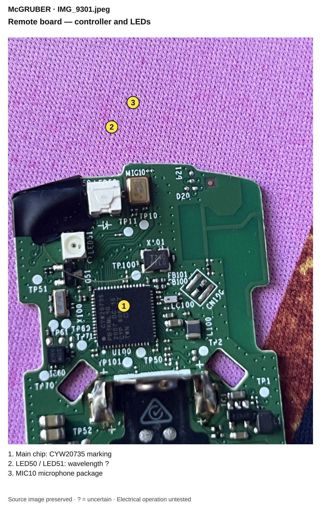](../media/parts/2026-10-25/IMG_9301_annotated.svg)

[Open source photo](../media/parts/2026-10-25/IMG_9301.jpeg) · [Open annotated image](../media/parts/2026-10-25/IMG_9301_annotated.svg)

Uploaded names: IMG_9301(2).jpeg, IMG_9301.jpeg.

### IMG_9302.jpeg — Remote board — controller and power area

**Donor / group:** Amazon R-NZ remote. **Status:** Not electrically tested.

- U100 main controller
- Power circuitry: exact chip functions ?
- Not a verified optical receiver

[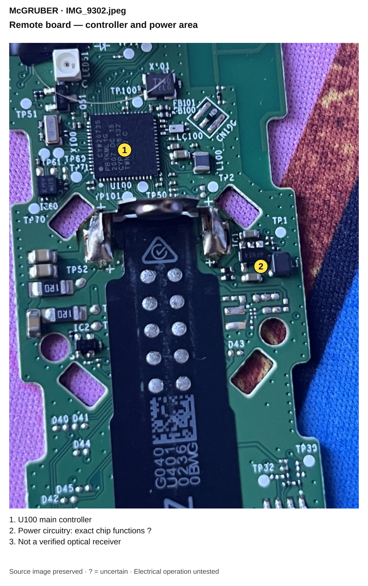](../media/parts/2026-10-25/IMG_9302_annotated.svg)

[Open source photo](../media/parts/2026-10-25/IMG_9302.jpeg) · [Open annotated image](../media/parts/2026-10-25/IMG_9302_annotated.svg)

Uploaded names: IMG_9302(1).jpeg.

### IMG_9303.jpeg — Remote board — LED close-up

**Donor / group:** Amazon R-NZ remote. **Status:** Not electrically tested.

- White LED package: wavelength ?
- Nearby metal-can component: microphone candidate ?

[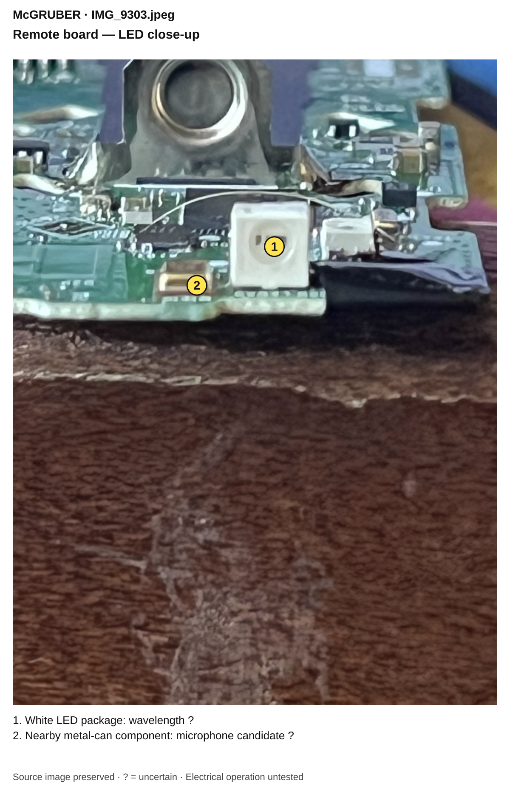](../media/parts/2026-10-25/IMG_9303_annotated.svg)

[Open source photo](../media/parts/2026-10-25/IMG_9303.jpeg) · [Open annotated image](../media/parts/2026-10-25/IMG_9303_annotated.svg)

Uploaded names: IMG_9303(1).jpeg.

### IMG_9304.jpeg — Remote board — pointing end

**Donor / group:** Amazon R-NZ remote. **Status:** Not electrically tested.

- LED packages: wavelength ?
- Battery contact in background

[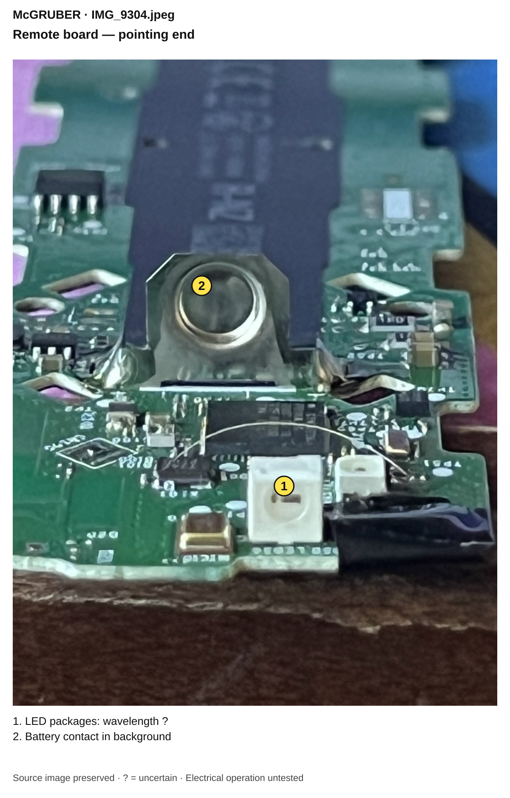](../media/parts/2026-10-25/IMG_9304_annotated.svg)

[Open source photo](../media/parts/2026-10-25/IMG_9304.jpeg) · [Open annotated image](../media/parts/2026-10-25/IMG_9304_annotated.svg)

Uploaded names: IMG_9304(1).jpeg.

### IMG_9305.jpeg — MF301 three-position terminal block

**Donor / group:** Loose parts / accessories. **Status:** Not electrically tested.

- Three PCB pins
- Wire connection openings

[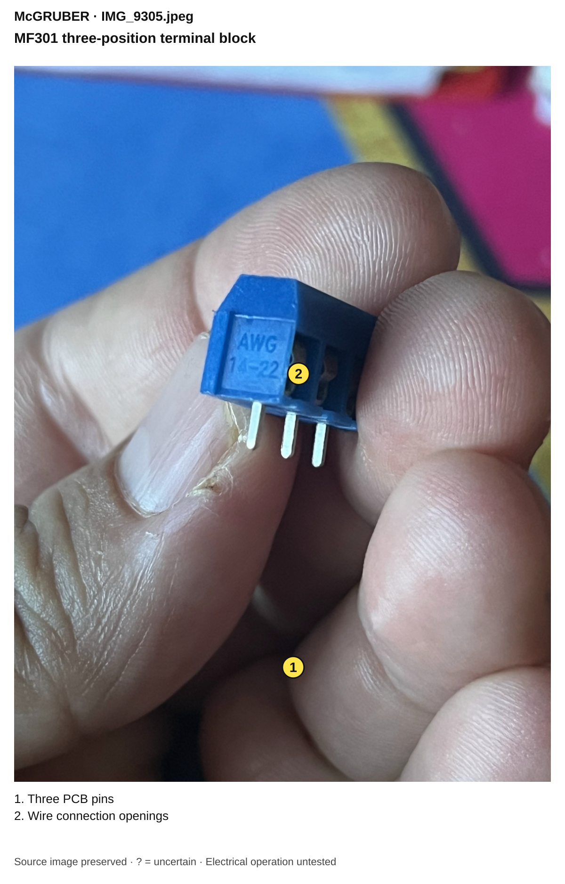](../media/parts/2026-10-25/IMG_9305_annotated.svg)

[Open source photo](../media/parts/2026-10-25/IMG_9305.jpeg) · [Open annotated image](../media/parts/2026-10-25/IMG_9305_annotated.svg)

Uploaded names: IMG_9305(1).jpeg.

### IMG_9306.jpeg — Terminal block — wire-size marking

**Donor / group:** Loose parts / accessories. **Status:** Not electrically tested.

- AWG 14–22 marking
- Same connector, another view

[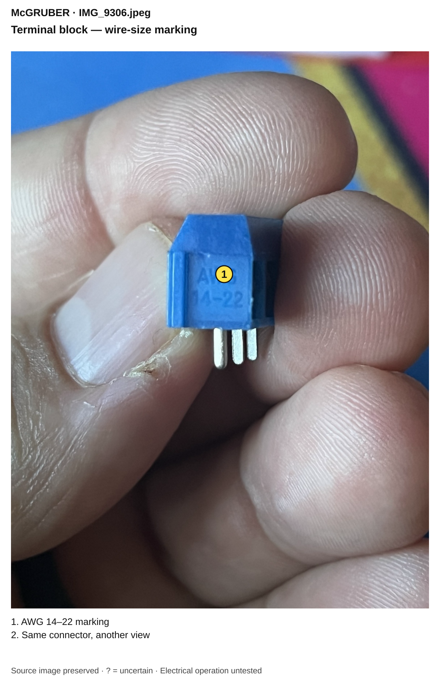](../media/parts/2026-10-25/IMG_9306_annotated.svg)

[Open source photo](../media/parts/2026-10-25/IMG_9306.jpeg) · [Open annotated image](../media/parts/2026-10-25/IMG_9306_annotated.svg)

Uploaded names: IMG_9306(1).jpeg.

### IMG_9307.jpeg — Terminal block — model marking

**Donor / group:** Loose parts / accessories. **Status:** Not electrically tested.

- MF301 marking
- 250VAC / 16A printed ratings; not measured

[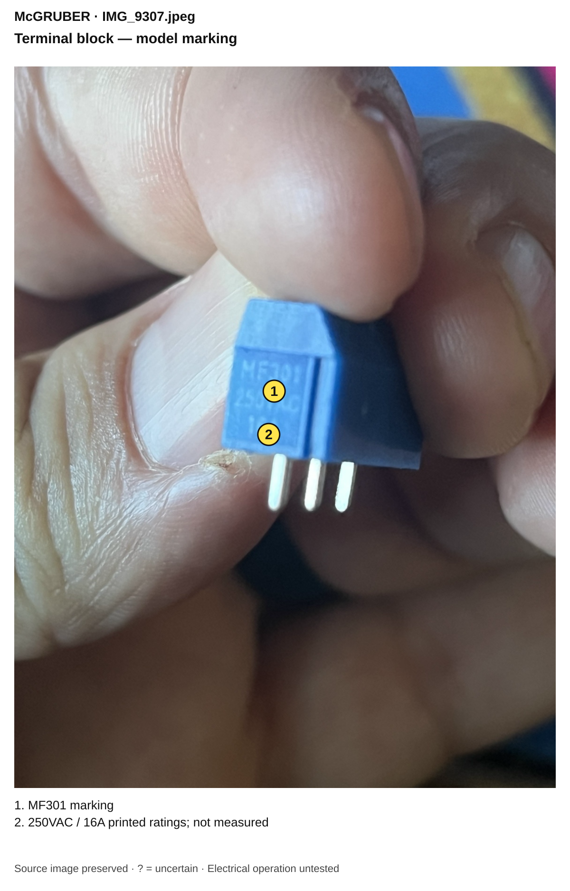](../media/parts/2026-10-25/IMG_9307_annotated.svg)

[Open source photo](../media/parts/2026-10-25/IMG_9307.jpeg) · [Open annotated image](../media/parts/2026-10-25/IMG_9307_annotated.svg)

Uploaded names: IMG_9307(1).jpeg.

### IMG_9308.jpeg — HP X3000 G2 mouse — underside

**Donor / group:** HP X3000 G2 mouse batch. **Status:** Not electrically tested.

- Model G66; HP X3000 G2
- Label: 1.5 V DC, 50 mA
- Optical opening

[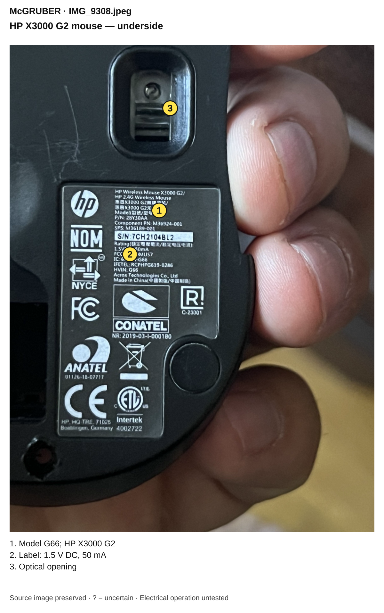](../media/parts/2026-10-25/IMG_9308_annotated.svg)

[Open source photo](../media/parts/2026-10-25/IMG_9308.jpeg) · [Open annotated image](../media/parts/2026-10-25/IMG_9308_annotated.svg)

Uploaded names: IMG_9308.jpeg.

### IMG_9309.jpeg — Mouse board — LED and power area

**Donor / group:** HP X3000 G2 mouse batch. **Status:** Not electrically tested.

- U2 optical navigation sensor candidate ?
- LED01: wavelength ?
- L1 inductor
- Black fabric cover: contents ?

[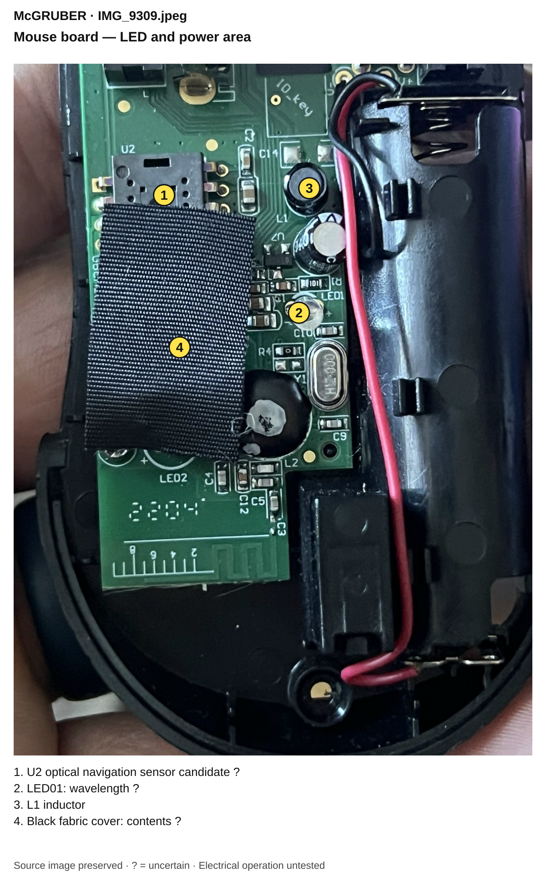](../media/parts/2026-10-25/IMG_9309_annotated.svg)

[Open source photo](../media/parts/2026-10-25/IMG_9309.jpeg) · [Open annotated image](../media/parts/2026-10-25/IMG_9309_annotated.svg)

Uploaded names: IMG_9309.jpeg.

### IMG_9310.jpeg — Mouse board — switches and encoder

**Donor / group:** HP X3000 G2 mouse batch. **Status:** Not electrically tested.

- Left and right click microswitches
- Scroll encoder
- Tactile pushbutton
- Battery holder / red-black leads
- U2 sensor candidate ?

[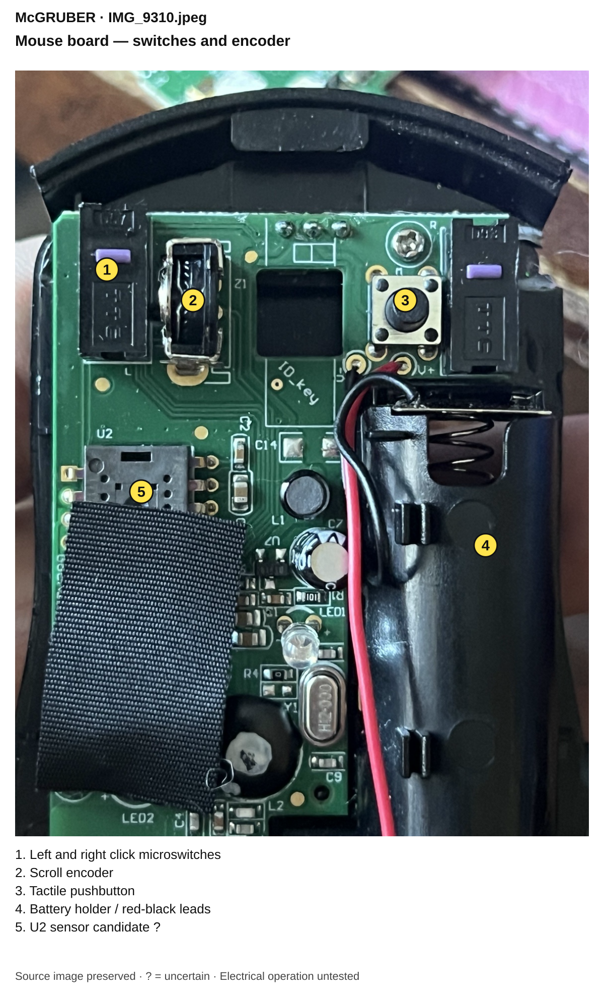](../media/parts/2026-10-25/IMG_9310_annotated.svg)

[Open source photo](../media/parts/2026-10-25/IMG_9310.jpeg) · [Open annotated image](../media/parts/2026-10-25/IMG_9310_annotated.svg)

Uploaded names: IMG_9310.jpeg.

### IMG_9311.jpeg — Mouse board — LED01 close-up

**Donor / group:** HP X3000 G2 mouse batch. **Status:** Not electrically tested.

- LED01: wavelength ?
- Y1 metal-can crystal
- Electrolytic capacitor
- Epoxy-covered electronics: identity ?

[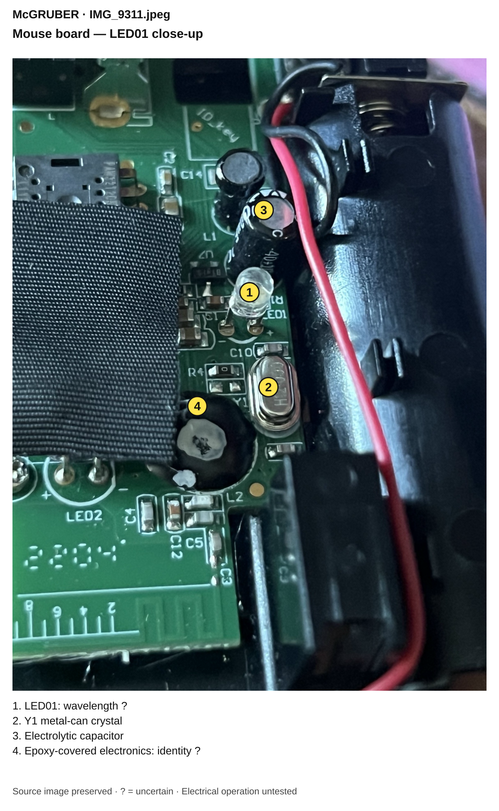](../media/parts/2026-10-25/IMG_9311_annotated.svg)

[Open source photo](../media/parts/2026-10-25/IMG_9311.jpeg) · [Open annotated image](../media/parts/2026-10-25/IMG_9311_annotated.svg)

Uploaded names: IMG_9311.jpeg.

### IMG_9312.jpeg — Mouse board — sensor side view

**Donor / group:** HP X3000 G2 mouse batch. **Status:** Not electrically tested.

- U2 navigation sensor candidate ?
- Scroll encoder side
- Capacitor: 100 µF 10 V marking
- LED01: wavelength ?

[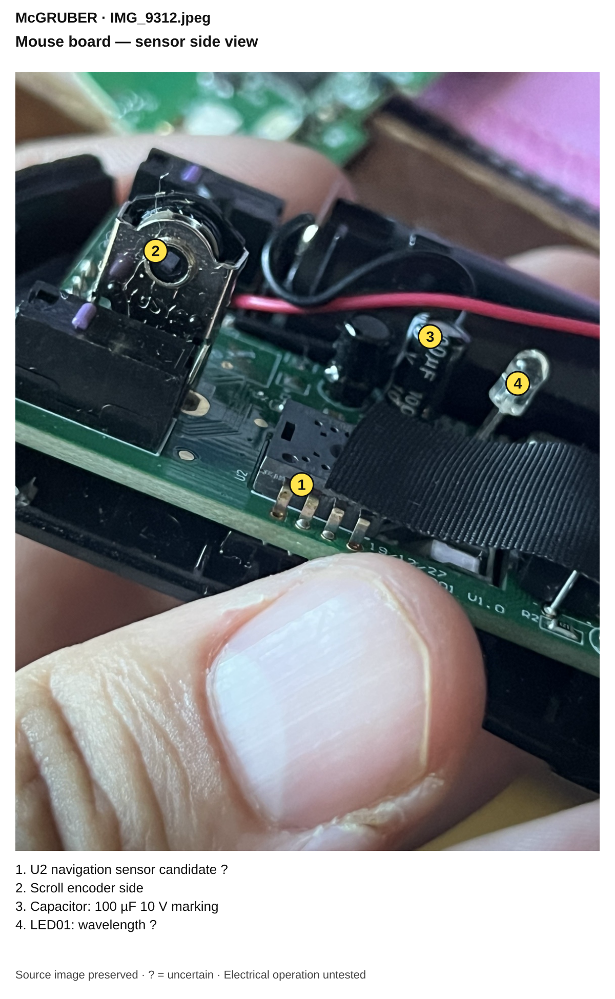](../media/parts/2026-10-25/IMG_9312_annotated.svg)

[Open source photo](../media/parts/2026-10-25/IMG_9312.jpeg) · [Open annotated image](../media/parts/2026-10-25/IMG_9312_annotated.svg)

Uploaded names: IMG_9312.jpeg.

### IMG_9313.jpeg — Mouse board — scroll encoder

**Donor / group:** HP X3000 G2 mouse batch. **Status:** Not electrically tested.

- Mechanical rotary scroll encoder
- Click microswitches
- Wheel removed; encoder visible

[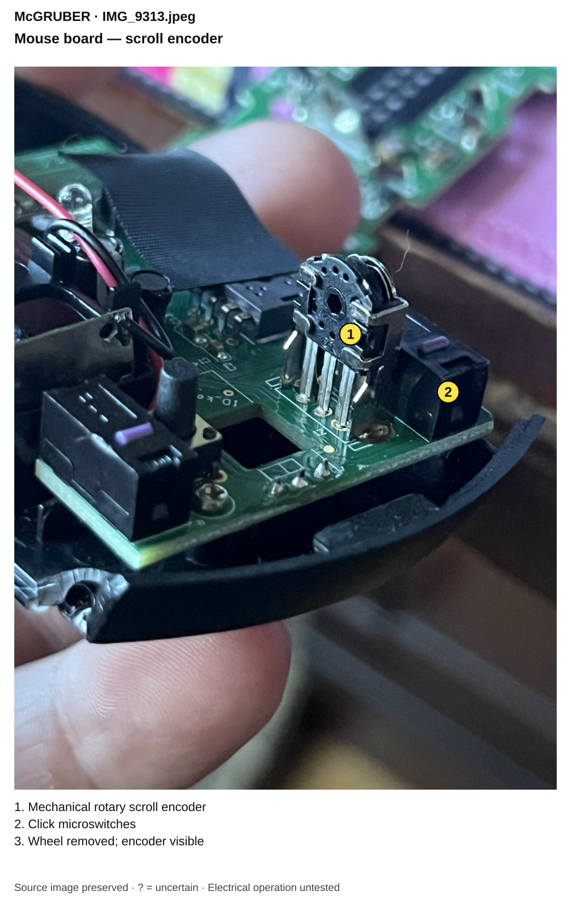](../media/parts/2026-10-25/IMG_9313_annotated.svg)

[Open source photo](../media/parts/2026-10-25/IMG_9313.jpeg) · [Open annotated image](../media/parts/2026-10-25/IMG_9313_annotated.svg)

Uploaded names: IMG_9313.jpeg.

### IMG_9314.jpeg — Mouse board — opposite overview

**Donor / group:** HP X3000 G2 mouse batch. **Status:** Not electrically tested.

- Two click microswitches
- Scroll encoder
- Tactile pushbutton
- U2 sensor candidate ?

[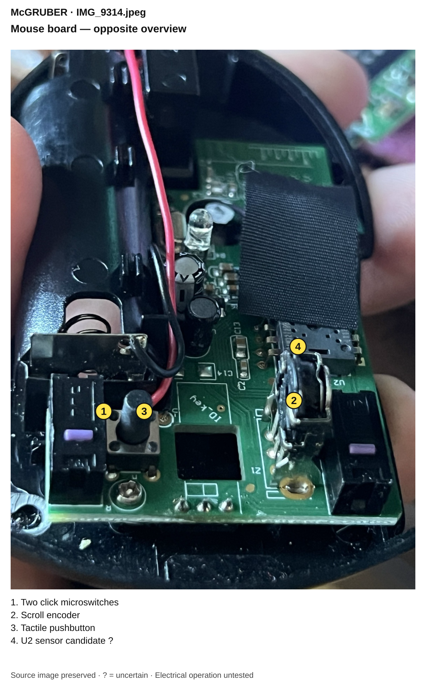](../media/parts/2026-10-25/IMG_9314_annotated.svg)

[Open source photo](../media/parts/2026-10-25/IMG_9314.jpeg) · [Open annotated image](../media/parts/2026-10-25/IMG_9314_annotated.svg)

Uploaded names: IMG_9314.jpeg.

### IMG_9315.jpeg — Mouse board — encoder and sensor

**Donor / group:** HP X3000 G2 mouse batch. **Status:** Not electrically tested.

- Scroll encoder
- U2 navigation sensor candidate ?
- LED01: wavelength ?
- Black fabric cover: contents ?

[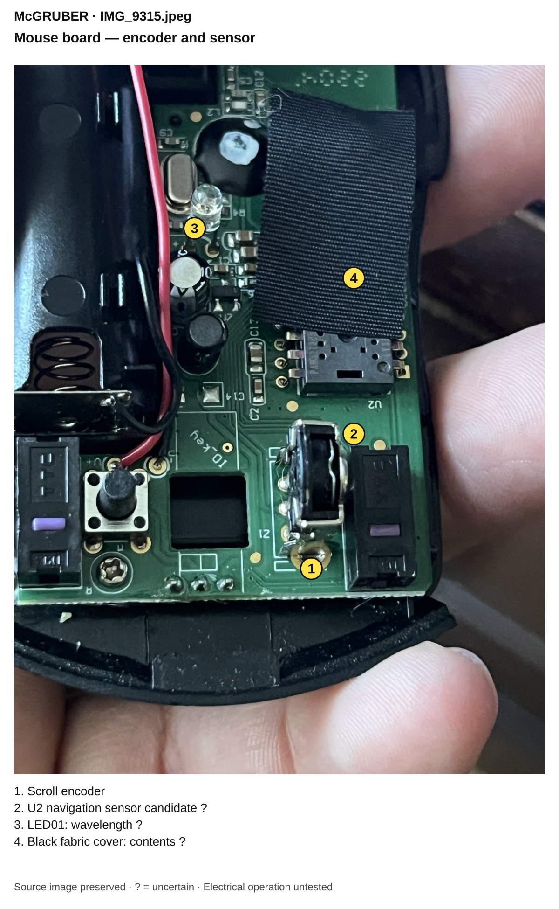](../media/parts/2026-10-25/IMG_9315_annotated.svg)

[Open source photo](../media/parts/2026-10-25/IMG_9315.jpeg) · [Open annotated image](../media/parts/2026-10-25/IMG_9315_annotated.svg)

Uploaded names: IMG_9315.jpeg.

### IMG_9316.jpeg — Mouse board — low side view

**Donor / group:** HP X3000 G2 mouse batch. **Status:** Not electrically tested.

- U2 sensor candidate package ?
- Black fabric cover
- LED and electrolytic capacitor

[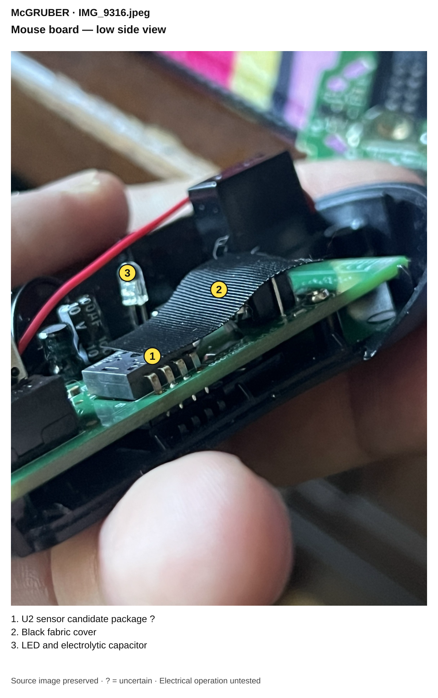](../media/parts/2026-10-25/IMG_9316_annotated.svg)

[Open source photo](../media/parts/2026-10-25/IMG_9316.jpeg) · [Open annotated image](../media/parts/2026-10-25/IMG_9316_annotated.svg)

Uploaded names: IMG_9316.jpeg.

### IMG_9317.jpeg — Mouse board — rear electronics

**Donor / group:** HP X3000 G2 mouse batch. **Status:** Not electrically tested.

- Y1 crystal: 12.000 marking
- LED01: wavelength ?
- Epoxy-covered electronics: identity ?
- U2 sensor candidate ?

[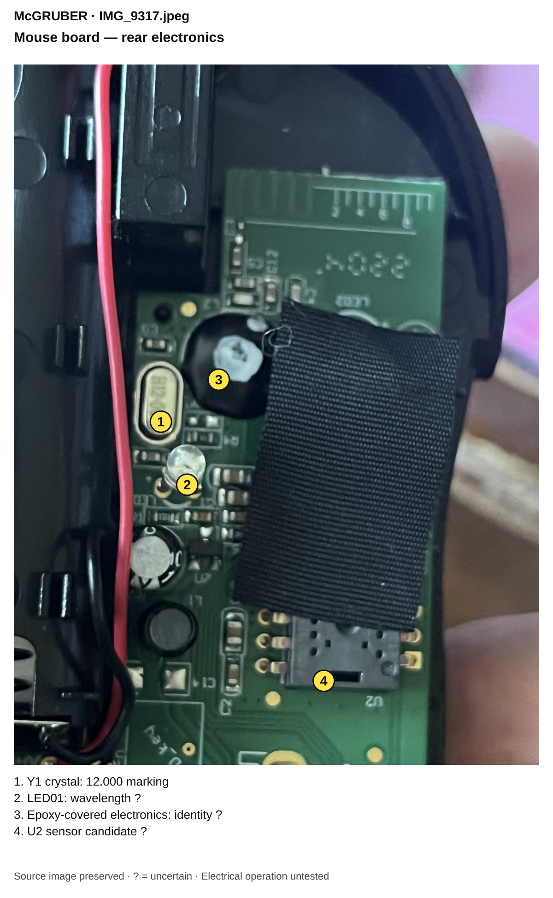](../media/parts/2026-10-25/IMG_9317_annotated.svg)

[Open source photo](../media/parts/2026-10-25/IMG_9317.jpeg) · [Open annotated image](../media/parts/2026-10-25/IMG_9317_annotated.svg)

Uploaded names: IMG_9317.jpeg.

## Parts / group records

### PHOTO-001 — 2N4401 NPN transistor

**Quantity:** At least 1. **Evidence:** Marking readable. **Status:** Not electrically tested.

**Earlier group:** REF-16.

**Potential use:** Warning LED output-switch candidate for B; does not complete optical detection.

**Limits / next check:** Verify exact manufacturer pinout and transistor function before wiring.

[IMG_9283.jpeg](../media/parts/2026-10-25/IMG_9283.jpeg) · [IMG_9295.jpeg](../media/parts/2026-10-25/IMG_9295.jpeg)

### PHOTO-002 — 2N4403 PNP transistor

**Quantity:** At least 1. **Evidence:** Marking readable. **Status:** Not electrically tested.

**Earlier group:** REF-16.

**Potential use:** Additional transistor stock; no assigned circuit role.

**Limits / next check:** Same part may appear in both photos; do not count twice or substitute for an NPN.

[IMG_9284.jpeg](../media/parts/2026-10-25/IMG_9284.jpeg) · [IMG_9286.jpeg](../media/parts/2026-10-25/IMG_9286.jpeg)

### PHOTO-003 — L7805CV — 5 V voltage regulator

**Quantity:** At least 1. **Evidence:** Marking readable. **Status:** Not electrically tested.

**Earlier group:** REF-16.

**Potential use:** Candidate regulator for a 5 V IR receiver supply using a suitable higher-voltage input.

**Limits / next check:** Not a working supply yet. Verify pinout, supporting capacitors, heat dissipation and loaded output. Cannot boost nominal 4.5 V to 5 V.

[IMG_9285.jpeg](../media/parts/2026-10-25/IMG_9285.jpeg)

### PHOTO-004 — 10 µF, 25 V electrolytic capacitor

**Quantity:** At least 1. **Evidence:** Marking readable. **Status:** Not electrically tested.

**Earlier group:** REF-16.

**Potential use:** Supporting power-filtering capacitor candidate.

**Limits / next check:** Observe polarity; capacitance, leakage and condition untested. Not a substitute for every required regulator bypass capacitor.

[IMG_9286.jpeg](../media/parts/2026-10-25/IMG_9286.jpeg)

### PHOTO-005 — Capacitor — value unknown ?

**Quantity:** At least 1. **Evidence:** Appearance only; value hidden. **Status:** Not electrically tested.

**Earlier group:** REF-16.

**Potential use:** Possible supporting capacitor after identification.

**Limits / next check:** Rotate to expose capacitance, voltage and polarity markings; do not assume it matches the other capacitor.

[IMG_9286.jpeg](../media/parts/2026-10-25/IMG_9286.jpeg)

### PHOTO-006 — USB dongles — exact functions unknown ?

**Quantity:** 3 pieces / 1 group. **Evidence:** Connector shape visible; function unknown. **Status:** Not electrically tested.

**Earlier group:** REF-13.

**Potential use:** Unassigned USB accessories; no optical receiver role confirmed.

**Limits / next check:** Need labels or device identification; do not infer Wi-Fi, Bluetooth or mouse compatibility from shape.

[IMG_9287.jpeg](../media/parts/2026-10-25/IMG_9287.jpeg)

### PHOTO-007 — Possible wire connectors — exact type unknown ?

**Quantity:** 2 paired assemblies visible / 1 group. **Evidence:** Appearance only; tentative identification. **Status:** Not electrically tested.

**Earlier group:** Not assigned; overlap with earlier stock unresolved.

**Potential use:** Possible connection hardware after identifying openings and wire requirements.

**Limits / next check:** Inspect openings, terminal mechanism and ratings; do not classify as sensors.

[IMG_9288.jpeg](../media/parts/2026-10-25/IMG_9288.jpeg)

### PHOTO-008 — PIC16F57-E/SP microcontroller

**Quantity:** 1 visible. **Evidence:** Marking readable in IMG_9297; earlier underside view in IMG_9289. **Status:** Not electrically tested.

**Earlier group:** REF-16.

**Potential use:** Programmable controller stock for later experiments; does not replace the sensitive optical frontend.

**Limits / next check:** Programming, suitable power and additional circuitry are required; no firmware or working receiver demonstrated.

[IMG_9289.jpeg](../media/parts/2026-10-25/IMG_9289.jpeg) · [IMG_9296.jpeg](../media/parts/2026-10-25/IMG_9296.jpeg) · [IMG_9297.jpeg](../media/parts/2026-10-25/IMG_9297.jpeg)

### PHOTO-009 — Empty IC socket

**Quantity:** 1 visible. **Evidence:** Open socket visible. **Status:** Not electrically tested.

**Earlier group:** REF-16.

**Potential use:** Holds a compatible IC on an appropriate assembly board.

**Limits / next check:** Not an amplifier or comparator; verify pin count and pitch.

[IMG_9289.jpeg](../media/parts/2026-10-25/IMG_9289.jpeg) · [IMG_9297.jpeg](../media/parts/2026-10-25/IMG_9297.jpeg)

### PHOTO-010 — Holder for three AAA batteries

**Quantity:** 1 holder. **Evidence:** Cell markings readable. **Status:** Not electrically tested.

**Earlier group:** REF-20.

**Potential use:** Potential removable-cell supply and mounting base.

**Limits / next check:** Two views of the same holder. Loose/cut wires require repair, continuity, polarity and voltage checks. Series wiring and switch operation not proven; do not call it a regulated 5 V source.

[IMG_9290.jpeg](../media/parts/2026-10-25/IMG_9290.jpeg) · [IMG_9291.jpeg](../media/parts/2026-10-25/IMG_9291.jpeg)

### PHOTO-011 — Alligator and clip-to-pin test leads

**Quantity:** At least two black and two red leads pictured. **Evidence:** Owner photographs; appearance and readable markings only. **Status:** Not electrically tested.

**Earlier group:** REF-22.

**Potential use:** Temporary low-voltage connections.

**Limits / next check:** Check continuity and insulation; do not infer ratings.

[IMG_9292.jpeg](../media/parts/2026-10-25/IMG_9292.jpeg) · [IMG_9293.jpeg](../media/parts/2026-10-25/IMG_9293.jpeg)

### PHOTO-012 — Metal-can crystal / resonator ?

**Quantity:** 1 visible. **Evidence:** Owner photographs; appearance and readable markings only. **Status:** Not electrically tested.

**Earlier group:** REF-16.

**Potential use:** Unassigned timing component candidate.

**Limits / next check:** Exact type, frequency and electrical function unverified.

[IMG_9294.jpeg](../media/parts/2026-10-25/IMG_9294.jpeg)

### PHOTO-013 — Resistor color-code reference card

**Quantity:** 1 reference card. **Evidence:** Owner photographs; appearance and readable markings only. **Status:** Not electrically tested.

**Earlier group:** Not assigned; overlap with earlier stock unresolved.

**Potential use:** Reference aid only.

**Limits / next check:** Does not verify any resistor value or quantity.

[IMG_9298.jpeg](../media/parts/2026-10-25/IMG_9298.jpeg)

### PHOTO-014 — Amazon R-NZ remote — detailed board evidence

**Quantity:** 1 donor board; multiple views. **Evidence:** Owner photographs; appearance and readable markings only. **Status:** Not electrically tested.

**Earlier group:** REF-10.

**Potential use:** Preserved donor board; LED emitter candidates only.

**Limits / next check:** No standalone IR receiver, continuous beam driver or amplifier confirmed. Eight-pin chip remains unidentified.

[IMG_9299.jpeg](../media/parts/2026-10-25/IMG_9299.jpeg) · [IMG_9300.jpeg](../media/parts/2026-10-25/IMG_9300.jpeg) · [IMG_9301.jpeg](../media/parts/2026-10-25/IMG_9301.jpeg) · [IMG_9302.jpeg](../media/parts/2026-10-25/IMG_9302.jpeg) · [IMG_9303.jpeg](../media/parts/2026-10-25/IMG_9303.jpeg) · [IMG_9304.jpeg](../media/parts/2026-10-25/IMG_9304.jpeg)

### PHOTO-015 — MF301 three-position PCB terminal block

**Quantity:** 1 connector; three views. **Evidence:** Owner photographs; appearance and readable markings only. **Status:** Not electrically tested.

**Earlier group:** Not assigned; overlap with earlier stock unresolved.

**Potential use:** Wire connections on a suitable soldered board.

**Limits / next check:** Earlier adjustable-resistor guess corrected. Terminal mapping and electrical condition untested; printed ratings are not measured.

[IMG_9305.jpeg](../media/parts/2026-10-25/IMG_9305.jpeg) · [IMG_9306.jpeg](../media/parts/2026-10-25/IMG_9306.jpeg) · [IMG_9307.jpeg](../media/parts/2026-10-25/IMG_9307.jpeg)

### PHOTO-016 — HP X3000 G2 mouse — teardown evidence

**Quantity:** 1 mouse donor; ten views. **Evidence:** Owner photographs; appearance and readable markings only. **Status:** Not electrically tested.

**Earlier group:** Not assigned; overlap with earlier stock unresolved.

**Potential use:** Click microswitches, scroll encoder, holder, wires and enclosure are salvage candidates.

**Limits / next check:** Internal parts remain assembled and untested. Exterior identified by readable label; board grouped by owner statement. U2 part number hidden; navigation function inferred. LED wavelength and chip identities unresolved; not a verified doorway receiver.

[IMG_9308.jpeg](../media/parts/2026-10-25/IMG_9308.jpeg) · [IMG_9309.jpeg](../media/parts/2026-10-25/IMG_9309.jpeg) · [IMG_9310.jpeg](../media/parts/2026-10-25/IMG_9310.jpeg) · [IMG_9311.jpeg](../media/parts/2026-10-25/IMG_9311.jpeg) · [IMG_9312.jpeg](../media/parts/2026-10-25/IMG_9312.jpeg) · [IMG_9313.jpeg](../media/parts/2026-10-25/IMG_9313.jpeg) · [IMG_9314.jpeg](../media/parts/2026-10-25/IMG_9314.jpeg) · [IMG_9315.jpeg](../media/parts/2026-10-25/IMG_9315.jpeg) · [IMG_9316.jpeg](../media/parts/2026-10-25/IMG_9316.jpeg) · [IMG_9317.jpeg](../media/parts/2026-10-25/IMG_9317.jpeg)

## Remaining tripwire gaps

- **B:** No suitable amplifier/threshold circuit identified; LED sensor measurements and circuit design still needed.
- **C:** No matched IR emitter/receiver pair identified. L7805CV is a candidate supply component, not a tested 5 V supply.

## References

- [ST L78 regulator datasheet](https://www.st.com/resource/en/datasheet/l78.pdf)
- [Microchip PIC16F54/57/59 datasheet](https://ww1.microchip.com/downloads/en/DeviceDoc/41201B.pdf)
- [Infineon CYW20735 manufacturer repository](https://github.com/Infineon/20735B1)
