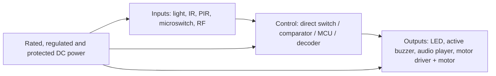

# Modular architecture

The reusable idea is **Detection → Control (when needed) → Output**, with appropriately rated power, protective circuitry and mechanical mounts.

Direct contacts can sometimes operate an appropriately rated low-voltage indicator without a controller. Sensor modules may instead need a threshold circuit, transistor or microcontroller. Never treat arbitrary signals as interchangeable; verify output voltages, currents, polarity, interface timing, common grounding and power requirements.

## Planned reusable interfaces
1. **Sensing module:** defined voltage range, signal polarity, maximum draw, connector pinout and mounting dimensions.
2. **Control module:** documented input thresholds, output drive capability, software revision if applicable.
3. **Output module:** rated current, driver/suppression, safe mechanical support.
4. **Power module:** overload protection and correctly rated output rails.
5. **Mechanical module:** source CAD, STL, tolerance and fit-test log.

## Reuse examples
- One active buzzer may serve object-removal, break-beam and control-box prototypes if compatible.
- One verified PIR module may initiate a prank sound or a robot response.
- Mouse microswitches can support simple triggers once their contacts are measured.

## Relationship to H.E.R.B.I.E.
Project McGruber is a learning and prototyping environment for reusable sensing, control, actuation and enclosure techniques that **may later inform** H.E.R.B.I.E. No electrical, mechanical, firmware or performance compatibility with H.E.R.B.I.E. has been established. Keep the designs separate until interfacing requirements and tests are documented.
