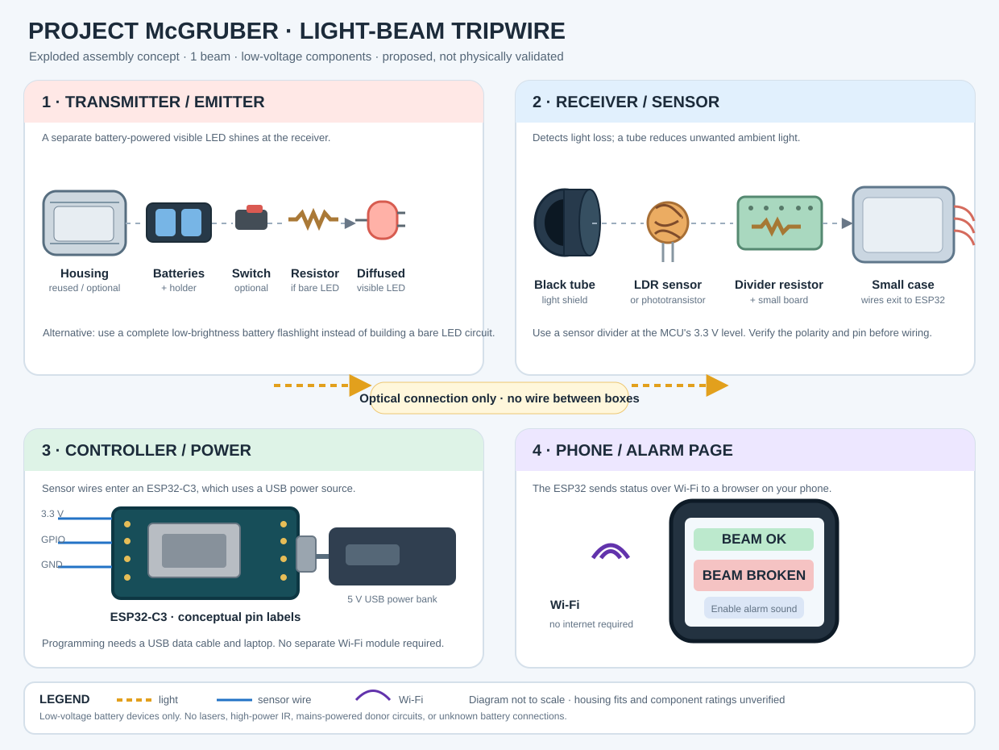

# Exploded assembly view — one visible-light tripwire



**Design maturity: concept only.** This is an assembly visualization, **not** an actual disassembled product photograph, a dimensioned CAD drawing, or an electrically validated wiring schematic. No new physical test is claimed. Actual component housings, ratings, and dimensions must be measured before cutting, soldering, or 3D-printing.

## The mental model

1. **Emitter (independent box):** battery + low-brightness diffused visible LED + *calculated* LED current-limiting resistor when needed. A ready-made battery flashlight is the easiest alternative. Optional switch and housing.
2. **Light path:** align the visible light toward the sensor. There is **no electrical connection** between emitter and receiver.
3. **Receiver:** an LDR/phototransistor points at the emitter through an optional black straw or tube to reduce ambient interference. The sensor needs an appropriate bias/voltage-divider arrangement.
4. **Controller:** three conceptual connections run from an LDR-divider receiver to the ESP32-C3: **3.3 V, signal to a suitable ADC-capable GPIO, and ground**. Pin numbers depend on the actual board. USB powers the ESP32 board from a correctly rated supply; the USB cable is also needed for initial programming.
5. **Phone:** ESP32 firmware can host a local Wi-Fi status webpage; no separate Wi-Fi module or native phone app is necessary. Sound generally requires user interaction and browser support, so the interface should include an **Enable Sound** control.

## Bill of materials for a one-beam Wi-Fi prototype

| Item | Needed? | First inexpensive/salvage option |
| --- | --- | --- |
| Low-brightness visible LED emitter **or** complete battery flashlight | Required | Salvage a working battery flashlight |
| Emitter battery supply and holder | Required | Keep a matched, intact toy/flashlight battery compartment |
| LED current-limiting resistor | Conditional | **Required for a bare LED unless rated current limiting is already included**; select value using the measured supply and LED specifications |
| LDR **or** phototransistor | Required | Identify part from a verified low-voltage light-sensor circuit, or buy one |
| Suitable sensor resistor(s) | Required for a bare LDR / phototransistor circuit | Verify with a multimeter; a complete sensor module may include these |
| ESP32-C3 (or suitable Wi-Fi microcontroller) | Required for this Wi-Fi version | A low-cost development board; a salvaged unidentified toy chip is not an equivalent drop-in |
| Wires, breadboard **or** suitable soldered connections | Required | Salvaged hookup wire; breadboard for repeatable experiments |
| Correct USB power supply and cable | Required | Existing 5 V USB power bank / adapter and compatible cable |
| Computer for initial firmware upload | Required during setup | Existing laptop |
| Smartphone and local Wi-Fi link | Required for phone version | Existing phone; ESP32 access-point mode may avoid needing a router |
| Two stable stands/mounts | Required | Cardboard or repurposed supports |
| Black sensor tube, cases, power switch | Optional | Drinking straw, small plastic box, salvaged switch |
| Physical buzzer and suitable driver | Optional | Add only after checking current, supply and interface ratings |
| Status LED, second beam, game timer, scoring | Optional | Later hardware/software upgrades |

## Connection concept (NOT a final pinout)

```text
[Emitter battery] -> [switch?] -> [current-limited LED] ~~~visible light~~~> [LDR / sensor]
                                                                               |
                                                  [bias or divider, 3.3 V max]
                                                                               |
                                                           [ESP32-C3 ADC input]
                                                                               |
                                     [USB 5 V supply] -> [ESP32-C3] ~~Wi-Fi~~> [phone webpage]
```

**Example only for a bare LDR:** a common arrangement is `3.3 V -> LDR -> measured ADC signal node -> suitable fixed resistor -> GND`. The correct resistance, thresholds, and ADC pin must be determined from the selected LDR, board datasheet and real room-light tests. A phototransistor may need a different circuit; don't substitute it without redesigning the input. **Never feed 5 V from USB or an unregulated solar panel into a 3.3 V GPIO.**

## Suggested assembly sequence

1. Inventory actual parts, photograph markings, verify batteries and LED current limit; do not take apart mains-powered devices.
2. Aim the flashlight/LED at an independently measured LDR sensor. Record readings with beam on, beam blocked, and room lights changed.
3. Breadboard the sensor divider and verify the entire signal stays within the ESP32 input ratings before plugging it in.
4. Wire sensor to the ESP32; flash minimal firmware that shows sensor readings over USB.
5. Add a simple Wi-Fi page with **Beam detected / Beam broken**, then calibrate threshold, hysteresis and minimum trigger duration to reject flicker.
6. Put the emitter and receiver in stable mounts, test at short distances and log repeated successful/failed beam breaks.
7. Only then add alarm sound, housing, power switches, or another beam.

## Why not treat this as a finished build?

The original [project status](README.md), [circuit notes](CIRCUIT.md), [build guide](BUILD.md), and [test log](TEST_LOG.csv) remain authoritative: hardware operation has not been independently verified. Keep actual measurements, dimensions, photographs, datasheets and results separate from this proposed illustration.

## Safety

Use isolated low-voltage DC supplies, a low-brightness diffused visible LED below eye height, and short supervised beam paths. **Do not use lasers, invisible high-power IR, mains circuitry from plug-in lights, or damaged/unknown rechargeable cells.** Recheck polarity, component ratings and controller pinout. See [safety rules](../../docs/SAFETY.md).

[Project home](README.md) · [existing conceptual architecture](diagrams/architecture.svg) · [parts inventory](../../component-bank/README.md)
