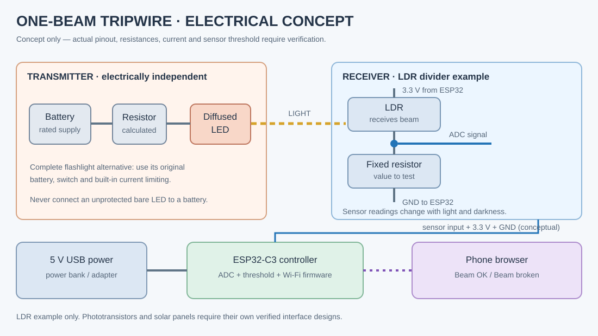

# Tripwire build decision and verification workbook

> **Conceptual engineering aid, not a tested circuit.** This supplements [the exploded assembly](diagrams/exploded-assembly.svg) and [assembly notes](ASSEMBLY_VIEW.md). No actual dimensions, electrical measurements, sensor performance, or successful ESP32 upload have been established.

## Pick one route

| Route | Hardware | Phone alert? | What to validate first |
| --- | --- | --- | --- |
| A — local-only alarm | Low-brightness LED flashlight, LDR/phototransistor, suitable switching/threshold circuit, buzzer and safe power | No | Sensor polarity, threshold, buzzer driver/current |
| B — Wi-Fi phone alert | Same emitter and light sensor, sensor resistor, ESP32-C3, USB power and data cable | Yes | ADC voltage, firmware upload, webpage connectivity |
| C — salvaged solar-panel experiment | Low-brightness flashlight, salvaged low-voltage solar cell, multimeter, appropriate conditioning circuit | Only with additional controller | Open-circuit voltage, illuminated/blocked response and input protection |

**Recommended first build: Route B** if the phone alert is essential; otherwise Route A is cheaper but needs a correctly designed threshold/switching circuit. A solar garden light is a *donor candidate*, not a drop-in sensor module.

## Exploded physical stack

### Emitter side
1. Base or stable support
2. Battery holder and compatible battery supply
3. Optional on/off switch
4. Appropriate current limiting for a bare LED; omit only when the complete light already has a rated limiter
5. Diffused low-brightness visible LED or a complete battery flashlight
6. Optional housing, clip and low-position beam guide

### Receiver side
1. Base or stable support
2. Black tube / short straw to reject side lighting
3. LDR or phototransistor, identified by marking and measurement
4. Divider/bias components, suitable for that exact sensor
5. Breadboard or secured low-voltage connections
6. ESP32-C3 with correctly identified ADC-capable GPIO and 3.3 V/GND
7. USB power source, optional protective enclosure
8. Phone browser connected to the ESP32 Wi-Fi network or same LAN

## Measurements to collect before wiring a controller

| Test | Equipment | Record | Stop condition |
| --- | --- | --- | --- |
| Battery supply | Multimeter DC volts | Voltage and polarity | Unidentified, reversed or out-of-rating supply |
| Emitter | Meter and verified LED specification | Supply, LED forward voltage, resistor and measured current | Excessive current, overheating, eye discomfort |
| Sensor alone | Multimeter | Response under beam, blocked beam, lights on/off | No repeatable difference |
| Divider output | Meter DC volts | Lowest/highest signal voltage | Outside selected ESP32 ADC GPIO limits |
| Controller USB | Compatible USB supply | Stable power and programming connection | Unexpected heat, reset loops, incorrect USB voltage |
| Wi-Fi alert | Phone browser | Connected/disconnected behavior, sound enable | Unreliable indication or misleading alarm |
| Alignment | Tape measure | Beam distance, height, number of successful blocks | Eye-level beam or frequent false triggers |

**No actual results have been entered yet.** Put physical observations in [TEST_LOG.csv](TEST_LOG.csv) and preserve failures, not just successful trials.

## Assembly checkpoints

- **Checkpoint 1 — Optical:** demonstrate the sensor reading changes when a hand interrupts the LED light.
- **Checkpoint 2 — Electrical:** demonstrate the conditioned signal remains within controller ratings.
- **Checkpoint 3 — Firmware:** display the actual ADC readings via USB, without a buzzer or other loads.
- **Checkpoint 4 — Phone:** show real sensor status over Wi-Fi. Provide a user-tapped sound-enable control and a visible disconnected status.
- **Checkpoint 5 — Mechanical:** measure the actual parts before making fitted housings or printable CAD.
- **Checkpoint 6 — Reliability:** test several lighting conditions, distances, and repeated crossings; log both misses and false alarms.

## Salvage acceptance checklist

| Donor item | Useful possibilities | Inspect first |
| --- | --- | --- |
| Battery flashlight | Complete emitter, switch, holder | Low brightness, batteries, voltage, beam spread |
| Battery toy with sound | Buzzer/speaker, switch, holder | Output ratings; speaker is not necessarily an active buzzer |
| Battery-powered solar garden light | LED, panel, battery holder, possible light-control IC | Cell chemistry, voltage and whether the sensor is actually usable |
| Low-voltage light-reactive toy | LDR/phototransistor | Component identification and safe removal |
| Old USB cable | Data/power wiring | Confirm data capability and connector condition |

Avoid mains plug-in night-lights, damaged lithium batteries, high-power IR and lasers. The project is for a supervised children's game; keep the beam below eye level and avoid startle hazards.

## Future 3D model requirements

Before publishing dimensionally accurate 3D-printable parts, record the **actual** LED diameter, sensor diameter, board outline, USB connector clearance, mounting hole locations, battery holder size, wall thickness, fastener choice and tolerances. An exploded illustration alone does not validate any of those dimensions.

See [project safety](../../docs/SAFETY.md) and [measurement protocol](../../docs/MEASUREMENT_PROTOCOL.md).
