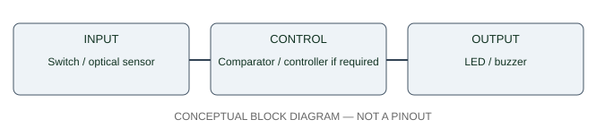

# Standalone visible tripwire — electrical interface specification

**Revision:** PRELIMINARY / engineering gate ENG-2026-10-24-A. **NOT** a verified pin-level complete optical receiver schematic. Refer to [engineering master plan](../../docs/ENGINEERING_MASTER_PLAN_2026-10-24.md) and [electrical field guide](../../docs/ELECTRONICS_ENGINEERING_FIELD_GUIDE.md).

## Split the circuit into five explicitly testable blocks

\`\`\`
SEPARATE TRANSMITTER: 9V+ -> verified 1kΩ series resistor -> BLUE LED -> 9V−
                                     optical beam (no wire)
SEPARATE RECEIVER:   RED spare LED / verified visible photodetector
                     -> weak analog light/dark signal [Fluke test only currently]
                     -> suitable high-impedance amplifier / sensor bias [UNIDENTIFIED]
                     -> threshold with hysteresis [UNIDENTIFIED]
                     -> NPN 2N4401 LED switching stage
                     -> red warning LED, silent
RECEIVER SOURCE:     verified low-voltage supply sized to actual circuits
\`\`\`

### A — Powered blue emitter

For a **typical** ordinary visible low-current LED powered by an actually measured ~9V source: 9V positive → **measured 1 kΩ series resistor** → LED anode → LED cathode → 9V negative. Calculate measured current from series resistor voltage; do not bypass resistor. The blue LED photographed on the NightFire Color Organ board does not automatically receive current limiting from that largely unpopulated PCB. Mounting ≠ electrical wiring.

### B — Receiver identification

The loose **red LED** from inventory #23 is an experimental photodiode, **unpowered** during the Fluke test. Collect at least ten **DC** light-on, dark-blocked and restored readings at a fixed 1–3-inch geometry. Log the Fluke meter jack/range and connection polarity. If drifting or ambient-light dominated, mark the sensor test failed. Prior 8.1–11 mV **AC** values are not proof of a usable DC amplifier input; user has described a subsequent blue-light test as working but not provided a reproducible DC table.

### C — Required amplification and threshold (NOT DESIGNED)

No identified high-impedance amplifier, comparator, LDR, standalone phototransistor or matching analog front end is confirmed owned. A loose red LED with a few mV of contrast does not adequately forward-bias a normal NPN transistor base. Needed functions:

- Light-sensitive part selected for blue wavelength and target range.
- Proper bias and high-input-impedance current/voltage amplification without saturating in room light.
- Reference threshold, hysteresis to prevent chatter, stable response under 50/60 Hz lighting.
- Defined output polarity and source/sink current into a known LED driver.
- Safe supply, decoupling and current budget for **identified ICs only**.

The exact schematic must await data, not AI-guessed chip markings. TI's [comparator hysteresis guide](https://www.ti.com/tool/CIRCUIT060073) and ADI's [photodiode interface note](https://www.analog.com/en/resources/analog-dialogue/articles/programmable-gain-transimpedance-amplifiers.html) are **engineering references**, not a ready-made tested McGruber circuit.

### D — 2N4401 manual test **before** attaching optics

With pinout actually verified for the exact device:

\`\`\`
9V (+) --> 1kΩ (measured) --> WARNING LED anode (+)
                             WARNING LED cathode (−) --> 2N4401 collector (C)
9V (−) ------------------------------------------------> 2N4401 emitter (E)
9V (+) --> temporary touch point --> 10kΩ (measured) -> 2N4401 base (B)
Optional: ~100kΩ base to emitter -> reliable OFF when touch point open
\`\`\`

WARNING light ON only while base driven through 10 kΩ; OFF otherwise. Disconnect 9V while moving any wiring. **This proves the output transistor stage ONLY.** It does not prove a laser, light detector, photosensor interface or long range.

**Pin caution:** onsemi's 2N4401 and alternative manufacturer device sheets differ in TO-92 lead numbering and/or package illustration. Do not infer actual leg order from prior generated images; match exact package view and Fluke diode test before wiring.

### E — Complete autonomous behavior (future integration)

\`\`\`
Blue source ON, receiver sees beam -> red warning OFF
Opaque block intersects path       -> red warning ON
Beam restored                      -> warning OFF
Emitter power lost                 -> treat as interrupted / fault, not silently safe
Receiver supply lost               -> define visible fail indication or explicitly note limitation
\`\`\`

### Physical wiring and enclosure

Separate transmitting and receiving battery rigs, no wire across door. Hold LEDs in short opaque light shields and stable nonconductive mounts. Tape/splices used for short tests only, individually insulated; prefer tested solderless board/perfboard for final build. Clearances, strain relief, battery access and eye-safe LED orientation are not optional.

## Release test matrix

| Gate | Test | Acceptance |
| --- | --- | --- |
| EMIT-01 | Check 9V source/resistor/current | Measured voltage, series resistor and nominal current; no shorts/heat |
| PHOTO-01 | Receiver DC A/B/A x10 | Repeatable response aligned with illumination at a known range |
| NPN-01 | Manual base touch through 10kΩ x3 | ON while touched, OFF when released; correct C/B/E |
| ANALOG-01 | Sensor drives transistor **without touch** | Automatic ON only during block, no oscillation with ambient light |
| OPTIC-01 | Increase physical spacing | 10/10 at each claimed distance plus two-minute idle |
| FINAL-01 | Mounted target distance | 30/30 once-only event indications and zero false alerts in 15 minutes |
| RECOVERY-01 | Lost emitter power, receiver restart | Documented safe state and reproducible return |

**No gate above should be retroactively marked as measured by a software build or concept image.** See [phone-specific result records](FIELD_TEST_2026-10-23.md) and [test log](TEST_LOG.csv).

