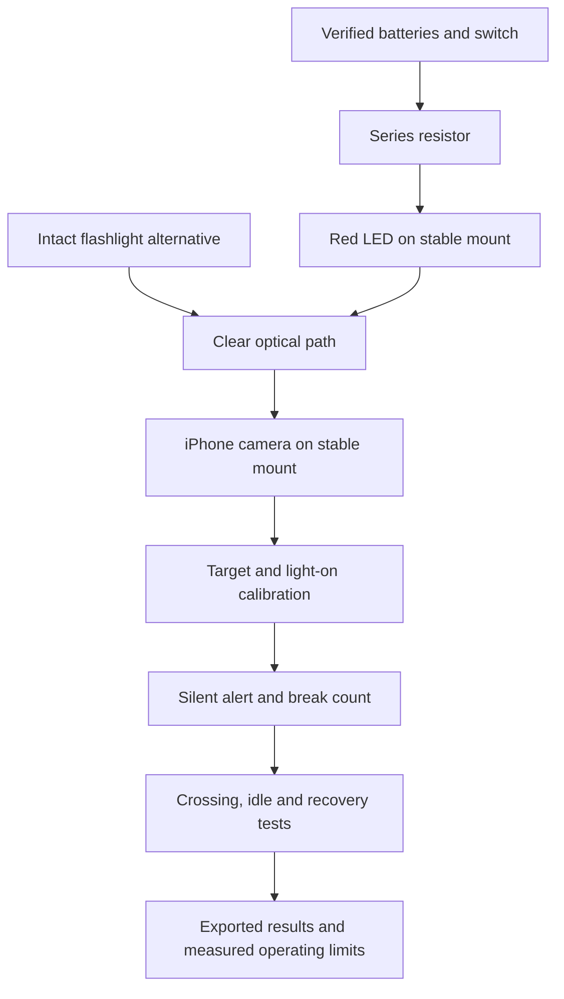

# Entire tripwire project: build map and completion gates

## Two routes in the current V5 project

**Phone receiver:** the camera and software serve as the light-signal interface. This is the route to qualify first.

**Standalone receiver:** the [existing hardware lab](../../web/public/beam-detector/standalone-lab.html) already guides emitter checks, unpowered LED DC-response experiments, shielding, verified 2N4401 pin identification and an isolated switching test. Those stages do not establish a complete optical receiver. The unresolved gate is a stable sensor plus amplification and threshold switching. Exact topology and parts cannot be finalized until sensor light/dark measurements, supply voltage and actual chip identities are known.

| Standalone stage | What can be built/tested now | Gate before proceeding |
|---|---|---|
| Emitter | Verified source plus series current limiting | Measured supply/current within identified ratings |
| Sensor experiment | Unpowered spare LED into DC-mV meter, controlled blocking | Repeatable ON/BLOCKED/RESTORED contrast, not drift |
| Switching experiment | Existing lab’s resistor-limited transistor test | Verified manufacturer pinout and repeatable manual switching |
| Automatic optical interface | Characterize signal and identify available ICs | **BLOCKED:** no proven amplifier/threshold topology yet |
| Complete receiver | Assemble only from a verified interface design | Actual light interruption controls indicator without hand switching |
| Range and enclosure | Test independently of phone range | Fresh range, ambient, recovery and fixed-rig evidence |

The following ordered build is for the phone route. A phone pass must never mark the standalone receiver complete.

## Version 1 scope

One low-voltage light source across a passage from a stationary iPhone. Camera software detects lost light and shows a silent alert. No speaker, microphone, microcontroller, reflector or semiconductor receiver board is required. A visible LED is a point of light, not a glowing line in ordinary air.

## What exists and what is missing

| Subsystem | Already prepared | Still needed to finish |
|---|---|---|
| Emitter | Intact flashlight route and conditional LED wiring | Identify the exact working red source; do not dismantle or change it before recording it |
| DIY power | Holder #20 reported; polarity/voltage procedure | Cell format, actual wiring, switched voltage and measured polarity |
| Current limiting | Resistor #19 and LED #23 reported; calculation guide | Actual resistance, LED polarity/rating, resistor voltage and calculated current |
| Connections | Clip leads #22 reported | Continuity, insulated joints, strain relief and separation of exposed clips |
| Emitter mount | Household supports are sufficient in principle | Stable support that holds alignment without tipping |
| Phone mount | Books, clamp or stand may work | Secure phone without blocking lens, controls or charging access |
| Optics | Camera target; optional dark cardboard shade | Exact alignment, background glare and verified useful distance |
| Detector app | Automatic count, hysteresis, stale-frame shutdown and startup readiness | Actual iPhone trials; keep Safari foregrounded and screen awake |
| Test runner | Range records, ten/thirty crossings, two/five/fifteen-minute checks | Operator tally of every crossing and real stationary monitoring |
| Evidence | Owner-reported nominal 1–15 ft outcomes preserved | Exact source, app version, measured distances, lighting, missed/extra counts and exports |
| Recovery | Software invalidates stopped/changed-camera trials | Owner test of restart, re-arm and restored alignment |
| Storage | Local attempt history and JSON export | Download a backup; local Safari storage is not cloud storage |

Presence in the inventory does not establish electrical compatibility or working condition. Existing range reports are useful progress, not independently verified specifications.

## Ordered build: do these in sequence

1. **Record the working setup.** Note app header/version, light source, phone/lens, measured separation and lighting. Photograph only hardware if useful. Leave working wiring unchanged.
2. **Prove the receiver at short range.** Aim and arm once; perform ten full one-second interruptions, restoring the light between them. Count exactly one response per actual crossing.
3. **Verify power before a DIY emitter.** Inspect the holder with cells removed, confirm matching alkaline cell format, then measure DC voltage, switch and polarity. If uncertain, use the intact flashlight.
4. **Identify LED and resistor.** Measure resistance unpowered; identify LED polarity and rating. The 330-ohm/4.5-volt example is conditional, not a universal prescription for an unidentified LED.
5. **Wire with power off.** Battery positive → resistor → LED anode → LED cathode → battery negative. Insulate joints and prevent clips from touching.
6. **Measure powered behavior.** Check supply and resistor voltage in DC-voltage mode. Compute current as 1000 × resistor volts / measured ohms, in mA. Never put current/resistance mode across the battery. Stay within the identified LED rating.
7. **Construct the two mounts.** Use stable nonconductive supports, secure the phone and light, route wiring away from passage, and keep the source away from faces. Measure fit before repurposing a mouse shell. An optional enclosure is not a gate for the first prototype.
8. **Align the installed optical path.** Select matching sensing mode, tap the source and re-arm after position, distance, lens or lighting changes. Add a short dark shade only if it improves the measured signal and does not cover the lens.
9. **Validate actual range.** Test 6 inches, 1, 3, 6, 10 and 15 feet separately. At each intended distance perform ten crossings and two minutes clear. Stop where reliability fails; do not increase unknown LED current to force range.
10. **Qualify the normal game.** At the chosen mounted distance pass ten crossings, five minutes clear, restoration, and stop/restart/re-arm recovery. Test slow, fast and partial crossings separately; brief occlusions may be missed.
11. **Qualify the stronger fixed rig.** Select 30 crossings and 15 minutes in the app. Observe one count per crossing, then leave the light uninterrupted. Repeat relevant trials in daylight, artificial lighting and dim conditions.
12. **Freeze and save the working configuration.** Label source, supply, resistor, mounting positions and distance. Export results, retain failures and record the actual limits. A six-foot pass is not a fifteen-foot pass.

## Physical shopping / preparation checklist

**First prototype:** iPhone, existing intact flashlight or already working red source, two stable supports, blocking card, tape measure and a clear test area. Check battery/phone charge before the timed run.

**DIY source only:** identified red indicator LED, measured series resistor, verified holder, correct matching alkaline cells, insulated leads and Fluke multimeter. Reuse existing parts before buying anything. The holder's cell size and resistor/LED ratings remain measurement questions.

**Helpful, optional:** tape/heat-shrink insulation, reusable clamp, cardboard alignment marks, short dark camera shade, protective enclosure and appropriate phone charging cable. Route charging and battery leads clear of feet. Do not assume a mouse lens gives useful long-range optics.

## Finish line

A working Version 1 is a mounted, measured setup with automatic silent detection, one count per observed crossing, no false trips over its selected idle interval, restoration, restart recovery and exported results. Software tests cannot complete those physical gates remotely.

Only afterward consider multiple beams/receivers, a same-side reflector, standalone receiver electronics, battery-life optimization or measured custom CAD. These are separate builds, not missing ingredients for the phone prototype.

## Source instructions

- [Build and electrical checks](PHONE_BUILD_TEST.md)
- [Existing field report](FIELD_TEST_2026-10-23.md)
- [Wiring diagram](diagrams/phone-led-wiring.svg)
- [Blank physical log](PHONE_TEST_LOG.csv)
