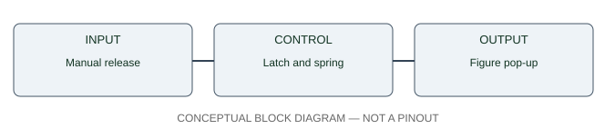

# Pop-Up Surprise Box — circuit and interface architecture

**The SVG is a block diagram, NOT an exact pin-level wiring schematic.** Physical pins, output logic, current, supply and component ratings are unknown until inspected and recorded.

- Input: Manual release
- Control: Latch and spring
- Output: Figure pop-up

Never connect DC motors directly to MCU GPIO; never connect an unknown 12V signal to a 3.3V/5V input. Use real manufacturer datasheets for the final circuit drawing.
