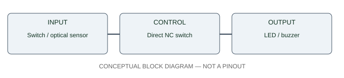

# Object-Removal Alarm — circuit and interface architecture

**The SVG is a block diagram, NOT an exact pin-level wiring schematic.** Physical pins, output logic, current, supply and component ratings are unknown until inspected and recorded.

- Input: Switch / optical sensor
- Control: Direct NC switch
- Output: LED / buzzer

**Conditional 5V indicator example:** `+5V → tested COM/NC → 470 Ω (0.25W) → rated red LED anode → LED cathode → ground`. Check contact behavior unpowered. Short-LED upper-bound resistor power at 5V = 25/470 = 0.053W, upper-bound current = 5/470 = 10.64mA. Verify that LED continuous current rating exceeds this bound and source really delivers 5V; neither was established here.

Never connect DC motors directly to MCU GPIO; never connect an unknown 12V signal to a 3.3V/5V input. Use real manufacturer datasheets for the final circuit drawing.
