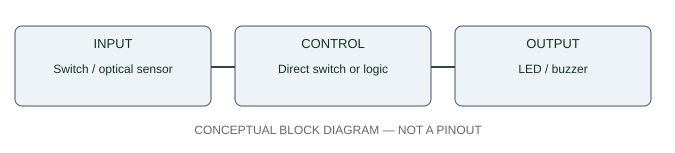

# Standalone Alarm / Control Box — circuit and interface architecture

**The SVG is a block diagram, NOT an exact pin-level wiring schematic.** Physical pins, output logic, current, supply and component ratings are unknown until inspected and recorded.

- Input: Switch / optical sensor
- Control: Direct switch or logic
- Output: LED / buzzer

**Conditional 5V audible example:** `+5V → arm switch → tested COM/NC switch → verified 5V ACTIVE buzzer positive`; buzzer negative to 0V. Confirm the buzzer load is below switch contact rating; use a driver otherwise. A passive piezo is NOT interchangeable.

Never connect DC motors directly to MCU GPIO; never connect an unknown 12V signal to a 3.3V/5V input. Use real manufacturer datasheets for the final circuit drawing.
